<picture>
  <source media="(prefers-color-scheme: dark)" srcset=".github/assets/header-dunkel.svg">
  
</picture>

     

<h3 align="center">Run models where your data lives.</h3>

Everything below the agent: local inference engines, gateways and model routers, open and decision models, fine-tuning and efficiency, SDKs, plus computer vision, 3D, video understanding, robotics and the ML foundations under it all. Sorted by what you do with a model, from running it on a Mac to teaching it to see.

<!-- onboarding:start -->
### In 3 Minuten startklar

<picture>
  <source media="(prefers-color-scheme: dark)" srcset=".github/assets/onboarding-dunkel.svg">
  
</picture>

1. **Start here.** Oben unter [Start here](#start-here) stehen 4 Picks, einer je Rolle. Fang mit dem an, der zu deiner Lücke passt.
2. **Rubrik.** Unter [Contents](#contents) die Rubrik wählen: 594 Repos, jedes genau einmal einsortiert, nach der Aufgabe, die es erledigt.
3. **Ausprobieren.** Den Pick öffnen und seine Install-Zeile ausführen; die Sterne zeigen, wie viele ihn schon nutzen.
4. **Dranbleiben.** Dieser Liste einen Stern geben: neue Picks erscheinen in deinem GitHub-Feed.

**Was du davon hast**

- 594 Repos rund um AI Models, nach Aufgabe sortiert, statt tagelang selbst zu suchen.
- Jeder Pick sagt in einem Satz, wofür er gut ist.
- Aufgenommen wird nur, was öffentlich ist, eine Lizenz hat und heute läuft.

**Nächster Schritt:** Fehlt ein Repo? Über [CONTRIBUTING.md](CONTRIBUTING.md) vorschlagen, ein Satz zur Aufgabe genügt; mehr Listen auf [github.com/Wellux](https://github.com/Wellux).
<!-- onboarding:end -->

## Start here

No time for 594 repos? Start with these 4, one per role. Add the rest when you feel the gap.

| Role | Pick | Why |
|:--|:--|:--|
| **Run** | [ollama](https://github.com/ollama/ollama) `★ 185.1k` | Pull and run open models on your own machine with one command |
| **Route** | [litellm](https://github.com/BerriAI/litellm) `★ 62.3k` | One OpenAI-format API for 100+ providers with budgets and cost logs |
| **Fine-tune** | [unsloth](https://github.com/unslothai/unsloth) `★ 78.7k` | Local UI to train and run LLMs and diffusion models with less memory |
| **Learn** | [nanochat](https://github.com/karpathy/nanochat) `★ 59.1k` | Build a small ChatGPT end to end for about $100 to see how it works |

<picture>
  <source media="(prefers-color-scheme: dark)" srcset=".github/assets/map-dunkel.svg">
  
</picture>

## Contents

- [Local inference](#local-inference) · 54 [Inference engines and servers](#inference-engines-and-servers) · [Apple Silicon and MLX](#apple-silicon-and-mlx) · [Local model apps and kits](#local-model-apps-and-kits)
- [Serving and efficiency](#serving-and-efficiency) · 24 [Quantization and compression](#quantization-and-compression) · [Kernels, decoding and GPUs](#kernels-decoding-and-gpus)
- [Gateways and routing](#gateways-and-routing) · 34 [LLM gateways](#llm-gateways) · [Model routers](#model-routers) · [Coding-agent provider proxies](#coding-agent-provider-proxies)
- [Open models](#open-models) · 44 [Language and reasoning models](#language-and-reasoning-models) · [Vision-language and omni models](#vision-language-and-omni-models) · [Model hubs and free APIs](#model-hubs-and-free-apis)
- [System One decision models](#system-one-decision-models) · 31 [Built with Jev](#built-with-jev) · [Open decision models](#open-decision-models) · [SDKs, guides and lists](#sdks-guides-and-lists)
- [Training and fine-tuning](#training-and-fine-tuning) · 42 [Fine-tuning toolkits](#fine-tuning-toolkits) · [RL and post-training](#rl-and-post-training) · [LLMs from scratch](#llms-from-scratch)
- [SDKs and ML frameworks](#sdks-and-ml-frameworks) · 45 [API clients and LLM CLIs](#api-clients-and-llm-clis) · [ML frameworks and model tools](#ml-frameworks-and-model-tools)
- [Computer vision](#computer-vision) · 130 [Detection and segmentation](#detection-and-segmentation) · [Object and point tracking](#object-and-point-tracking) · [Face detection and recognition](#face-detection-and-recognition) · [Pose, hands, eyes and gestures](#pose-hands-eyes-and-gestures) · [Vision libraries and lists](#vision-libraries-and-lists)
- [3D and spatial AI](#3d-and-spatial-ai) · 41 [Gaussian splatting and NeRF](#gaussian-splatting-and-nerf) · [3D reconstruction and SLAM](#3d-reconstruction-and-slam)
- [Video understanding](#video-understanding) · 45 [Video LLMs and long video](#video-llms-and-long-video) · [Action recognition and datasets](#action-recognition-and-datasets)
- [Robotics and driving](#robotics-and-driving) · 18 [Robot learning and embodied AI](#robot-learning-and-embodied-ai) · [Self-driving and driver assistance](#self-driving-and-driver-assistance)
- [Machine learning foundations](#machine-learning-foundations) · 86 [Classic ML, NLP and graphs](#classic-ml-nlp-and-graphs) · [Bayesian methods and optimization](#bayesian-methods-and-optimization) · [ML and data science courses](#ml-and-data-science-courses)

## Local inference

Run open models on your own hardware.

### Inference engines and servers

- **[ollama](https://github.com/ollama/ollama)** `★ 185.1k` · **Top pick.** Run open models locally with one command.
- **[llama.cpp](https://github.com/ggml-org/llama.cpp)** `★ 132.7k` · **Top pick.** LLM inference in C/C++ for running open models on your own machine.
- **[vllm](https://github.com/vllm-project/vllm)** `★ 95.8k` · High-throughput model serving.
- **[LocalAI](https://github.com/mudler/LocalAI)** `★ 50k` · Drop-in local replacement for the OpenAI API.
- **[Strata](https://github.com/Niko1221/Strata)** `★ 35.4k` · Inference engine for running Qwen on consumer hardware, with one-click Windows and Linux installs.
- **[llamafile](https://github.com/mozilla-ai/llamafile)** `★ 26.5k` · Distributes and runs LLMs from a single file.
- **[mlc-llm](https://github.com/mlc-ai/mlc-llm)** `★ 23.3k` · LLM deployment engine built on machine learning compilation.
- **[web-llm](https://github.com/mlc-ai/web-llm)** `★ 19.3k` · Engine that runs LLMs inside the browser.
- **[OpenLLM](https://github.com/bentoml/OpenLLM)** `★ 12.6k` · Runs open-source LLMs such as DeepSeek and Llama as OpenAI-compatible API endpoints.
- **[petals](https://github.com/bigscience-workshop/petals)** `★ 10.7k` · Runs LLMs at home BitTorrent-style, with distributed inference and fine-tuning.
- **[magnitude](https://github.com/magnitudedev/magnitude)** `★ 7.5k` · Inference engine that tunes its kernels on your hardware to run each model as fast as possible.
- **[vllm-omni](https://github.com/vllm-project/vllm-omni)** `★ 7.4k` · Framework for efficient inference of omni-modality models.
- **[executorch](https://github.com/pytorch/executorch)** `★ 5.1k` · On-device AI runtime for PyTorch across mobile, embedded and edge.
- **[audio.cpp](https://github.com/0xShug0/audio.cpp)** `★ 3.8k` · Pure C++ engine on ggml that runs TTS, speech-to-text, VAD and voice conversion models locally.
- **[sie](https://github.com/superlinked/sie)** `★ 3.5k` · Self-hosted inference server and cluster for embeddings, reranking, OCR and other agent models.
- **[ik_llama.cpp](https://github.com/ikawrakow/ik_llama.cpp)** `★ 3.3k` · Fork of llama.cpp with extra quantization types and improved performance.
- **[recipes](https://github.com/vllm-project/recipes)** `★ 1.1k` · Common recipes for running vLLM.
- **[PS5LM](https://github.com/cobanov/PS5LM)** `★ 736` · Port of llama.cpp that runs GGUF models natively on a jailbroken PS5.
- **[OpenArc](https://github.com/SearchSavior/OpenArc)** `★ 545` · Serves LLMs, VLMs, speech and embedding models over OpenAI endpoints on Intel devices.
- **[mlxcel](https://github.com/lablup/mlxcel)** `★ 482` · High-performance inference for LLMs, VLMs, embeddings and audio on Apple Silicon, CUDA and ROCm.
- **[qxotic](https://github.com/qxoticai/qxotic)** `★ 183` · Java AI runtime on GraalVM with CUDA, speech recognition and embeddings.
- **[VindexLLM](https://github.com/tinyBigGAMES/VindexLLM)** `★ 72` · LLM inference engine in pure Delphi that runs GGUF models on the GPU via Vulkan compute shaders.

### Apple Silicon and MLX

- **[mlx-lm](https://github.com/ml-explore/mlx-lm)** `★ 7.5k` · **Top pick.** Runs LLMs on Apple silicon with MLX.
- **[mlx](https://github.com/ml-explore/mlx)** `★ 29k` · Array framework for machine learning on Apple silicon.
- **[omlx](https://github.com/jundot/omlx)** `★ 23.1k` · Apple Silicon LLM inference server with continuous batching and SSD caching.
- **[ml-stable-diffusion](https://github.com/apple-aiml-research/ml-stable-diffusion)** `★ 18k` · Stable Diffusion running on Apple Silicon through Core ML.
- **[mlx-examples](https://github.com/ml-explore/mlx-examples)** `★ 9k` · Example projects built with the MLX framework.
- **[ANE](https://github.com/maderix/ANE)** `★ 7.3k` · Trains neural networks on the Apple Neural Engine through reverse-engineered private APIs.
- **[mlx-vlm](https://github.com/Blaizzy/mlx-vlm)** `★ 5.7k` · Inference and fine-tuning of vision-language models on Macs with MLX.
- **[Rapid-MLX](https://github.com/raullenchai/Rapid-MLX)** `★ 4k` · OpenAI- and Anthropic-compatible LLM inference server for Apple Silicon.
- **[claude-code-local](https://github.com/nicedreamzapp/claude-code-local)** `★ 3.4k` · Runs Claude Code fully on-device with local MLX models through an Anthropic-compatible server.
- **[mlx-swift-examples](https://github.com/ml-explore/mlx-swift-examples)** `★ 2.7k` · Example apps built with MLX Swift.
- **[neural-engine](https://github.com/hollance/neural-engine)** `★ 2.5k` · Everything known about the Apple Neural Engine.
- **[mlx-serve](https://github.com/ddalcu/mlx-serve)** `★ 2.1k` · Native LLM inference server for Apple Silicon with OpenAI and Anthropic compatible APIs.
- **[mlx-swift](https://github.com/ml-explore/mlx-swift)** `★ 2.1k` · Swift API for the MLX array framework.
- **[vllm-mlx](https://github.com/waybarrios/vllm-mlx)** `★ 1.6k` · OpenAI- and Anthropic-compatible LLM inference server for Apple Silicon with native MLX.
- **[chat-with-mlx](https://github.com/qnguyen3/chat-with-mlx)** `★ 1.6k` · All-in-one LLM chat UI for Apple Silicon Macs built on the MLX framework.
- **[mlx-engine](https://github.com/lmstudio-ai/mlx-engine)** `★ 1.2k` · Apple MLX engine used by LM Studio.
- **[mlxstudio](https://github.com/jjang-ai/mlxstudio)** `★ 989` · All-in-one MLX engine and app for running LLMs on a Mac.
- **[mlx-router](https://github.com/henrybravo/mlx-router)** `★ 8` · OpenAI-compatible inference server for Apple Silicon that hot-swaps between MLX models.

### Local model apps and kits

- **[gpt4all](https://github.com/nomic-ai/gpt4all)** `★ 77.4k` · Desktop app for running local LLMs on any device.
- **[textgen](https://github.com/oobabooga/textgen)** `★ 47.7k` · Open-source desktop app for local LLMs with vision, tool calling and an OpenAI-compatible API.
- **[jan](https://github.com/janhq/jan)** `★ 45.1k` · Open-source ChatGPT alternative that runs fully offline on your computer.
- **[llama-gpt](https://github.com/getumbrel/llama-gpt)** `★ 10.9k` · Self-hosted, offline ChatGPT-style chatbot powered by Llama 2.
- **[ODS](https://github.com/Osmantic/ODS)** `★ 7.7k` · Local AI setup for a PC, Mac or Linux box built on Docker, llama.cpp and ComfyUI.
- **[smolvlm-realtime-webcam](https://github.com/ngxson/smolvlm-realtime-webcam)** `★ 5.6k` · Real-time webcam demo of SmolVLM served through the llama.cpp server.
- **[lms](https://github.com/lmstudio-ai/lms)** `★ 5.4k` · Command-line interface for LM Studio.
- **[local-llm](https://github.com/jamesob/local-llm)** `★ 1.9k` · Personal collection of know-how for running LLMs locally.
- **[Portable-Local-Studio](https://github.com/techjarves/Portable-Local-Studio)** `★ 1.6k` · Portable local AI studio for image generation, GGUF LLMs, text to speech and speech to text.
- **[gemma-chat](https://github.com/ammaarreshi/gemma-chat)** `★ 1.4k` · Local AI chat and coding agent for Apple Silicon, running Gemma 4 on MLX or Ollama.
- **[Belullama](https://github.com/ai-joe-git/Belullama)** `★ 209` · Bundles Ollama, Open WebUI and Automatic1111 into one app, packaged for CasaOS.
- **[PortableLM](https://github.com/orailnoor/PortableLM)** `★ 162` · Air-gapped local AI environment that runs from a USB drive or portable SSD.
- **[awesome-local-ai](https://github.com/boxabirds/awesome-local-ai)** `★ 61` · Configurations for getting the most out of local AI setups.
- **[Keys-Setup-Autonomous-Self-Improving-Local-Inference-Stack](https://github.com/drowzeys/Keys-Setup-Autonomous-Self-Improving-Local-Inference-Stack)** `★ 24` · Recipe for a self-improving local inference stack on DGX Spark machines with routing and LoRA.

<a href="#contents">back to contents</a>

## Serving and efficiency

From one GPU to a cluster, faster and smaller.

### Quantization and compression

- **[Model-Optimizer](https://github.com/NVIDIA/Model-Optimizer)** `★ 5.5k` · **Top pick.** Library of model optimization techniques such as quantization, distillation and pruning.
- **[llm-compressor](https://github.com/vllm-project/llm-compressor)** `★ 3.9k` · **Top pick.** Compresses LLMs for production inference with vLLM.
- **[vector-quantize-pytorch](https://github.com/lucidrains/vector-quantize-pytorch)** `★ 4k` · PyTorch library for vector and scalar quantization.
- **[Awesome-Model-Quantization](https://github.com/AI-Efficiency/Awesome-Model-Quantization)** `★ 2.5k` · Curated papers, benchmarks, surveys and tools for model quantization.
- **[auto-round](https://github.com/intel/auto-round)** `★ 1.7k` · Post-training quantization for LLMs with accuracy close to quantization-aware training.
- **[KVCache-Factory](https://github.com/Zefan-Cai/KVCache-Factory)** `★ 1.4k` · Unified KV cache compression methods for auto-regressive models.
- **[Fast-Datafree](https://github.com/zju-vipa/Fast-Datafree)** `★ 75` · AAAI 2022 code for up to 100x faster data-free knowledge distillation.

### Kernels, decoding and GPUs

- **[ml-engineering](https://github.com/stas00/ml-engineering)** `★ 19.6k` · **Top pick.** Open book on machine learning engineering covering GPUs, debugging, training and inference.
- **[gpu-unlock](https://github.com/Zagitta/gpu-unlock)** `★ 12.4k` · Tool that claims up to 2x FP16, BF16 and TF32 tensor throughput on GeForce 20, 30 and 40 cards.
- **[DeepEP](https://github.com/deepseek-ai/DeepEP)** `★ 10.4k` · Efficient expert-parallel communication library for GPUs.
- **[DeepGEMM](https://github.com/deepseek-ai/DeepGEMM)** `★ 9.1k` · Clean and efficient BLAS kernel library for GPUs.
- **[GPTCache](https://github.com/zilliztech/GPTCache)** `★ 8.2k` · Semantic cache for LLMs, integrated with LangChain and llama_index.
- **[open-infra-index](https://github.com/deepseek-ai/open-infra-index)** `★ 8.1k` · Index of production-tested AI infrastructure tools from DeepSeek.
- **[gpu-perf-engineering-resources](https://github.com/wafer-ai/gpu-perf-engineering-resources)** `★ 4.3k` · Curated resources for learning AI performance engineering, from GPU basics to production inference.
- **[TransformerEngine](https://github.com/NVIDIA/TransformerEngine)** `★ 3.6k` · Library that accelerates Transformer models on NVIDIA GPUs, including FP8 and FP4 precision.
- **[ai-performance-engineering](https://github.com/cfregly/ai-performance-engineering)** `★ 2.1k` · Code and labs for O'Reilly's AI Systems Performance Engineering: GPUs, training and inference.
- **[InferenceX](https://github.com/SemiAnalysisAI/InferenceX)** `★ 1.9k` · Open-source research platform and benchmarks for AI accelerators.
- **[EAGLE-4](https://github.com/eagle-hq/EAGLE-4)** `★ 1k` · Official inference code for EAGLE-4 speculative decoding.
- **[OpenDLSS-NR](https://github.com/maanHimself/OpenDLSS-NR)** `★ 974` · Vulkan reimplementation of NVIDIA's DLSS neural rendering network, bit-exact to the original.
- **[speculators](https://github.com/vllm-project/speculators)** `★ 927` · Library for building, evaluating and storing speculative decoding algorithms for vLLM.
- **[llama-benchy](https://github.com/eugr/llama-benchy)** `★ 764` · Benchmarks speed of any OpenAI-compatible LLM endpoint in the style of llama-bench.
- **[mlx-dspark](https://github.com/ARahim3/mlx-dspark)** `★ 728` · MLX port of DSpark and DFlash speculative decoding for faster, lossless LLM decoding on Macs.
- **[llm-inference-handbook](https://github.com/modular/llm-inference-handbook)** `★ 472` · Handbook covering LLM inference, from optimization to infrastructure.
- **[metal2vk](https://github.com/joshuaswarren/metal2vk)** `★ 66` · Translates Metal GPU kernels of local AI engines such as mlx-lm and uzu to Vulkan for Linux.

<a href="#contents">back to contents</a>

## Gateways and routing

One endpoint for many providers, with keys, budgets and routing.

### LLM gateways

- **[litellm](https://github.com/BerriAI/litellm)** `★ 62.3k` · **Top pick.** One API for 100+ model providers, with budgets.
- **[gateway](https://github.com/Portkey-AI/gateway)** `★ 13.3k` · **Top pick.** AI gateway that routes to 1,600+ LLMs with built-in guardrails behind one API.
- **[OmniRoute](https://github.com/cheaper-inference/OmniRoute)** `★ 82.3k` · MIT-licensed AI gateway: one endpoint for 375 providers and more than 1,400 models.
- **[new-api](https://github.com/QuantumNous/new-api)** `★ 50.9k` · Self-hosted LLM gateway with OpenAI-, Claude- and Gemini-compatible APIs and model routing.
- **[one-api](https://github.com/songquanpeng/one-api)** `★ 37.3k` · LLM API management and distribution system that unifies many model providers behind one API.
- **[experiential](https://github.com/experientiallabs/experiential)** `★ 13.7k` · Open-source zero-markup gateway for BYOK, self-hosted and marketplace models.
- **[bifrost](https://github.com/maximhq/bifrost)** `★ 9.2k` · Open-source gateway that serves LLMs, MCP servers and agents behind one OpenAI-compatible API.
- **[ogx](https://github.com/ogx-ai/ogx)** `★ 8.4k` · Open agentic API server, formerly Llama Stack, with an OpenAI-compatible API for any model.
- **[llm-gateway](https://github.com/mnfst/llm-gateway)** `★ 7.6k` · Open-source LLM gateway with bring-your-own-key support.
- **[plano](https://github.com/katanemo/plano)** `★ 7.1k` · AI-native proxy and data plane for agentic apps with LLM routing, observability and orchestration.
- **[deepreasoning](https://github.com/winfunc/deepreasoning)** `★ 5.4k` · Inference API and chat UI that feeds DeepSeek R1 reasoning traces into Claude.
- **[openai-gemini](https://github.com/PublicAffairs/openai-gemini)** `★ 3.7k` · Serverless proxy that exposes Gemini through an OpenAI-compatible API.
- **[APIPark](https://github.com/APIParkLab/APIPark)** `★ 1.8k` · AI and API gateway for managing and distributing LLM APIs.
- **[llmgateway](https://github.com/theopenco/llmgateway)** `★ 1.7k` · Gateway that routes, manages and analyzes LLM requests across providers through one API.
- **[claude-to-chatgpt](https://github.com/jtsang4/claude-to-chatgpt)** `★ 1.3k` · Converts the Anthropic Claude API into the OpenAI chat API format.
- **[GoModel](https://github.com/ENTERPILOT/GoModel)** `★ 1.3k` · Go AI gateway with a unified OpenAI- and Anthropic-compatible API.
- **[uni-api](https://github.com/yym68686/uni-api)** `★ 1.3k` · Gateway that manages many LLM backends and calls them through one unified API.
- **[open-responses](https://github.com/open-responses/open-responses)** `★ 236` · Self-hosted alternative to OpenAI's Responses API that works with all model providers.
- **[autocache](https://github.com/montevive/autocache)** `★ 177` · Anthropic API proxy that adds cache-control fields to Claude requests automatically.
- **[OmniKey-AI-Unified-Key-Manager](https://github.com/Felix-au/OmniKey-AI-Unified-Key-Manager)** `★ 134` · Self-hosted LLM proxy and failover gateway for OpenAI- and Gemini-compatible endpoints.

### Model routers

- **[claude-code-router](https://github.com/musistudio/claude-code-router)** `★ 37.9k` · **Top pick.** Route agents across models and providers.
- **[ClawRouter](https://github.com/BlockRunAI/ClawRouter)** `★ 6.6k` · LLM router for autonomous agents with many frontier models behind one wallet and local routing.
- **[semantic-router](https://github.com/vllm-project/semantic-router)** `★ 6.3k` · Programmable decision layer that routes requests across models and compute.
- **[router](https://github.com/weave-os/router)** `★ 5.6k` · Model router that sends each prompt to the right model in under 50 ms to cut costs.
- **[cascadeflow](https://github.com/lemony-ai/cascadeflow)** `★ 3.9k` · Cascading runtime that balances cost, latency, quality and policy inside the agent loop.
- **[Switchyard](https://github.com/NVIDIA-NeMo/Switchyard)** `★ 3.5k` · Routes LLM traffic across models and providers while keeping native OpenAI and Anthropic APIs.
- **[Personal-AI-Router](https://github.com/NVIDIA/Personal-AI-Router)** `★ 1.7k` · Local router that sends each inference request to a suitable computer on your home network.
- **[WayfinderRouter](https://github.com/asdecided/WayfinderRouter)** `★ 418` · CLI that routes queries deterministically between local and hosted LLMs.

### Coding-agent provider proxies

- **[opencodex](https://github.com/lidge-jun/opencodex)** `★ 18k` · Provider proxy that lets Codex and Claude Code use other LLMs such as Gemini, Grok and Ollama.
- **[codex-router](https://github.com/duolahypercho/codex-router)** `★ 4k` · Local router that lets Codex use external models such as Kimi and DeepSeek, with safe rollback.
- **[1rgs/claude-code-proxy](https://github.com/1rgs/claude-code-proxy)** `★ 3.8k` · Proxy that lets Claude Code run on OpenAI models through an Anthropic-compatible API.
- **[fuergaosi233/claude-code-proxy](https://github.com/fuergaosi233/claude-code-proxy)** `★ 2.8k` · Proxy that lets Claude Code talk to OpenAI-compatible APIs.
- **[claude-code-nexus](https://github.com/KroMiose/claude-code-nexus)** `★ 251` · Proxy platform that forwards Claude Code requests to any OpenAI-compatible API service.
- **[claude-code-provider-gateway](https://github.com/danielalves96/claude-code-provider-gateway)** `★ 100` · Desktop app that runs a local gateway so Claude Code can use other providers and local models.

<a href="#contents">back to contents</a>

## Open models

Weights, families and model cards worth knowing.

### Language and reasoning models

- **[GLM-5](https://github.com/zai-org/GLM-5)** `★ 7.4k` · **Top pick.** Open language model aimed at agentic engineering and long-horizon coding.
- **[grok-1](https://github.com/xai-org/grok-1)** `★ 52.2k` · Open release of xAI's Grok-1 language model.
- **[unilm](https://github.com/microsoft/unilm)** `★ 22.2k` · Research code for large-scale pre-training across tasks, languages and modalities.
- **[OpenMythos](https://github.com/kyegomez/OpenMythos)** `★ 14.9k` · Theoretical reconstruction of the Claude Mythos architecture built from first principles.
- **[needle](https://github.com/cactus-compute/needle)** `★ 14.4k` · Tiny foundation model for devices that handles tool calls, speech recognition and embeddings.
- **[WizardLM](https://github.com/nlpxucan/WizardLM)** `★ 9.5k` · Open language models trained with Evol-Instruct, including WizardCoder and WizardMath.
- **[OpenChatKit](https://github.com/togethercomputer/OpenChatKit)** `★ 9k` · Open-source toolkit for building chatbots, with an instruction-tuned model and retrieval system.
- **[ERNIE](https://github.com/PaddlePaddle/ERNIE)** `★ 7.7k` · Official ERNIE 4.5 models with ERNIEKit, a development toolkit built on PaddlePaddle.
- **[open_llama](https://github.com/openlm-research/open_llama)** `★ 7.5k` · Permissively licensed open reproduction of LLaMA 7B trained on RedPajama.
- **[OLMo](https://github.com/allenai/OLMo)** `★ 6.7k` · Modeling, training, evaluation and inference code for the OLMo language models.
- **[text-to-text-transfer-transformer](https://github.com/google-research/text-to-text-transfer-transformer)** `★ 6.6k` · Code for the paper on transfer learning with a unified text-to-text Transformer.
- **[DeepSeek-V2](https://github.com/deepseek-ai/DeepSeek-V2)** `★ 5.1k` · Mixture-of-experts language model designed to be economical and efficient.
- **[smollm](https://github.com/huggingface/smollm)** `★ 3.9k` · Models and resources for the SmolLM and SmolVLM families.
- **[Awesome-LLM-Long-Context-Modeling](https://github.com/Xnhyacinth/Awesome-LLM-Long-Context-Modeling)** `★ 2.2k` · Curated papers and blog posts on long-context modeling for language models.
- **[Ornith-1](https://github.com/ornith-ai/Ornith-1)** `★ 2.1k` · Family of self-improving open-source models for agentic tasks.
- **[OpenCodeInterpreter](https://github.com/OpenCodeInterpreter/OpenCodeInterpreter)** `★ 1.8k` · Open-source code generation systems that aim to close the gap to GPT-4 Code Interpreter.
- **[VibeThinker](https://github.com/WeiboAI/VibeThinker)** `★ 1.6k` · 1.5B-parameter language model with large-model reasoning from diversity-driven optimization.
- **[Hy-MT2](https://github.com/Tencent-Hunyuan/Hy-MT2)** `★ 1.5k` · Multilingual translation models from Tencent Hunyuan in 1.8B, 7B and 30B-A3B sizes.
- **[mamba.py](https://github.com/alxndrTL/mamba.py)** `★ 1.5k` · Simple and efficient Mamba implementation in pure PyTorch and MLX.
- **[Spark-X2.6](https://github.com/XHToken/Spark-X2.6)** `★ 864` · Open model series focused on agentic capabilities for on-device use.
- **[mixture_of_recursions](https://github.com/raymin0223/mixture_of_recursions)** `★ 648` · LLM architecture research with adaptive per-token recursive depth (NeurIPS 2025).
- **[InternLM-Math](https://github.com/InternLM/InternLM-Math)** `★ 553` · Open bilingual language models built for mathematical reasoning.

### Vision-language and omni models

- **[CLIP](https://github.com/openai/CLIP)** `★ 34.5k` · **Top pick.** Contrastive Language-Image Pretraining model that predicts the most relevant text for an image.
- **[personaplex](https://github.com/NVIDIA/personaplex)** `★ 11.7k` · Real-time, full-duplex speech-to-speech model from NVIDIA with role prompts and voice control.
- **[ImageBind](https://github.com/facebookresearch/ImageBind)** `★ 9.1k` · Model that binds multiple modalities into one shared embedding space.
- **[CogVLM](https://github.com/zai-org/CogVLM)** `★ 6.7k` · Open visual language model for multimodal pre-training and image understanding.
- **[VLM-R1](https://github.com/om-ai-lab/VLM-R1)** `★ 6k` · Solves visual understanding tasks with vision-language models trained by reinforcement learning.
- **[Qwen2.5-Omni](https://github.com/QwenLM/Qwen2.5-Omni)** `★ 4.1k` · End-to-end multimodal model from the Qwen team that understands text, audio and vision.
- **[Skywork-R1V](https://github.com/SkyworkAI/Skywork-R1V)** `★ 3.2k` · Multimodal model series from Skywork AI for vision-language reasoning.
- **[Lance](https://github.com/bytedance/Lance)** `★ 1.4k` · Unified multimodal model for image and video understanding, generation and editing.
- **[AnomalyGPT](https://github.com/CASIA-LMC-Lab/AnomalyGPT)** `★ 1.1k` · Large vision-language model that detects industrial anomalies, from an AAAI 2024 paper.
- **[Chat-UniVi](https://github.com/PKU-YuanGroup/Chat-UniVi)** `★ 945` · CVPR 2024 model that unifies visual representation so LLMs understand images and video.
- **[PandaGPT](https://github.com/yxuansu/PandaGPT)** `★ 866` · One multimodal model that follows instructions across modalities (TLLM 2023).
- **[OpenVision](https://github.com/UCSC-VLAA/OpenVision)** `★ 503` · Family of open vision encoders for multimodal learning, now at OpenVision 3.
- **[attend2u](https://github.com/cesc-park/attend2u)** `★ 209` · Code for personalized image captioning with context sequence memory networks, from CVPR 2017.
- **[Obsidian](https://github.com/NousResearch/Obsidian)** `★ 205` · Experimental vision model from Nous Research.
- **[VINDEX](https://github.com/weihaox/VINDEX)** `★ 10` · ICCV 2025 research code on the visual feature space for multimodal neural decoding.

### Model hubs and free APIs

- **[llmfit](https://github.com/AlexsJones/llmfit)** `★ 38.5k` · **Top pick.** Finds which of hundreds of models and providers run on your hardware with one command.
- **[open-llms](https://github.com/eugeneyan/open-llms)** `★ 12.9k` · List of open large language models available for commercial use.
- **[modelscope](https://github.com/modelscope/modelscope)** `★ 9.2k` · Model hub that brings the Model-as-a-Service idea to life.
- **[awesome-freellm-apis](https://github.com/open-free-llm-api/awesome-freellm-apis)** `★ 4.8k` · Daily-updated directory of free LLM APIs with rate limits, base URLs and links to get keys.
- **[no-cost-ai](https://github.com/zebbern/no-cost-ai)** `★ 2.4k` · List of 80+ free AI services for chat, image, video, voice and APIs.
- **[awesome-openrouter](https://github.com/OpenRouterTeam/awesome-openrouter)** `★ 527` · Awesome list of apps that work with OpenRouter and its 300+ models.
- **[paperswithcode](https://github.com/huggingface/paperswithcode)** `★ 274` · Code of the site that tracks trending AI research with code, datasets and leaderboards.

<a href="#contents">back to contents</a>

## System One decision models

Fast typed decisions instead of chat: Jev, Laya and friends.

### Built with Jev

- **[jev-shell-history](https://github.com/mrnugget/jev-shell-history)** `★ 120` · Fish-style zsh history autosuggestions ranked by the Jev decision model.
- **[hunch](https://github.com/carldaws/hunch)** `★ 20` · Ruby gem for probabilistic control flow in Ruby and Rails, powered by TypeSafe's Jev.
- **[jev-skill-router](https://github.com/shimo4228/jev-skill-router)** `★ 20` · Claude Code hook that asks TypeSafe's Jev which installed skill to use.
- **[ComfyUI-TypedDecision](https://github.com/nomadoor/ComfyUI-TypedDecision)** `★ 11` · ComfyUI node that returns typed decisions with calibrated probabilities from a text encoder.
- **[codex-jev-router](https://github.com/suenot/codex-jev-router)** `★ 9` · JevRouter setup for cost-aware model selection across Codex subagents.
- **[pytest-jev](https://github.com/allebee/pytest-jev)** `★ 8` · Semantic assertions on LLM output for pytest, using Jev's calibrated probabilities.

### Open decision models

- **[laya](https://github.com/NandhaKishorM/laya)** `★ 34.6k` · **Top pick.** Non-autoregressive decision engine for typed choice, score and yes/no decisions over any text.
- **[ollaya](https://github.com/ollaya-dev/ollaya)** `★ 1.4k` · **Top pick.** Jev-compatible API server for open decision models, like Ollama for decision models.
- **[kev](https://github.com/jaredpalmer/kev)** `★ 9.7k` · Jev-style family of decision models built on Qwen that you can train and run yourself.
- **[laya-mlx](https://github.com/mizorewww/laya-mlx)** `★ 7k` · Native MLX runtime for Laya typed decision models on Apple silicon.
- **[SemIf-OpenJev](https://github.com/TheoLeeCJ/SemIf-OpenJev)** `★ 4.9k` · Semantic ifs from open models on a home 3090, independent of Jev and TypeSafe.
- **[decider](https://github.com/Mapika/decider)** `★ 1.2k` · System One-style models fine-tuned from Qwen3.5 for one-pass typed decisions.
- **[simple-jev](https://github.com/featherless-ai/simple-jev)** `★ 617` · Turns any open model into a classifier or Jev endpoint.
- **[imajev](https://github.com/mohit67890/imajev)** `★ 414` · Open Jev-style typed-decision model that also takes images.
- **[VideoJev](https://github.com/MCG-NJU/VideoJev)** `★ 270` · System One model for video understanding and interaction.
- **[SystemOneHarness](https://github.com/HarnessRouter/SystemOneHarness)** `★ 205` · Harness that runs Jev and other System One models locally or on HarnessRouter.
- **[OpenSourceJev](https://github.com/sabeel111/OpenSourceJev)** `★ 47` · Turns a general LLM into a Jev-like system.

### SDKs, guides and lists

- **[typesafe-sdk-python](https://github.com/typesafe-ai/typesafe-sdk-python)** `★ 303` · **Top pick.** Official Python library for the TypeSafe API.
- **[skills](https://github.com/typesafe-ai/skills)** `★ 2.8k` · Agent skills for building with TypeSafe's System One API.
- **[yibie/awesome-jev](https://github.com/yibie/awesome-jev)** `★ 2.5k` · Curated list of public projects, integrations and discussions built on TypeSafe AI's Jev model.
- **[awesome-jev-tools](https://github.com/v-modal/awesome-jev-tools)** `★ 751` · Curated list of tools built for Jev, TypeSafe AI's System One model.
- **[awesome-typesafe-jev](https://github.com/AbdelStark/awesome-typesafe-jev)** `★ 608` · Source-backed field guide to TypeSafe's System One model with SDKs, demos and agent tools.
- **[typesafe-sdk-js](https://github.com/typesafe-ai/typesafe-sdk-js)** `★ 285` · Official TypeScript and JavaScript library for the TypeSafe API.
- **[hellogumbo/awesome-jev](https://github.com/hellogumbo/awesome-jev)** `★ 222` · Community directory of projects built on Jev, TypeSafe AI's System One model.
- **[awesome-jev-typesafe](https://github.com/valentynkit/awesome-jev-typesafe)** `★ 188` · Awesome list on typed decisions with TypeSafe's Jev, the first System One model.
- **[building-with-typesafe-jev](https://github.com/aaddrick/building-with-typesafe-jev)** `★ 148` · Unofficial skill that teaches coding agents to build with TypeSafe's Jev decision model.
- **[Jev](https://github.com/cobusgreyling/Jev)** `★ 140` · Unofficial showcase of TypeSafe Jev for System One decisions rather than chat.
- **[cookbook](https://github.com/Jev-Engineering/cookbook)** `★ 30` · Sixty notebook recipes for typed decisions with Jev, from a first classification onward.
- **[typesafe-playground](https://github.com/TypeSafeAI/typesafe-playground)** `★ 26` · Community playground of 110 use cases, games and model challenges with editable prompts.
- **[TypeWright](https://github.com/Jev-Engineering/TypeWright)** `★ 7` · Lets you declare a decision, compile typed Jev questions, measure them and ship a JSON program.
- **[system1-vs-system2](https://github.com/PromtEngineer/system1-vs-system2)** `★ 2` · Chain test comparing one-pass Jev with Qwen 3.8 thinking on and off.

<a href="#contents">back to contents</a>

## Training and fine-tuning

Make a model yours.

### Fine-tuning toolkits

- **[unsloth](https://github.com/unslothai/unsloth)** `★ 78.7k` · **Top pick.** Fine-tune open models faster with less memory.
- **[LlamaFactory](https://github.com/hiyouga/LlamaFactory)** `★ 75.8k` · **Top pick.** Unified, efficient fine-tuning of more than 100 LLMs and VLMs.
- **[ms-swift](https://github.com/modelscope/ms-swift)** `★ 16k` · Toolkit to train 600+ LLMs with PEFT or full parameters using CPT, SFT, DPO and GRPO.
- **[easy-dataset](https://github.com/ConardLi/easy-dataset)** `★ 15k` · Tool for creating datasets for LLM fine-tuning, RAG and evaluation.
- **[Soup](https://github.com/MakazhanAlpamys/Soup)** `★ 9.8k` · Fine-tunes LLMs from one YAML file, even on a 4 GB laptop GPU.
- **[llm-datasets](https://github.com/mlabonne/llm-datasets)** `★ 4.8k` · Curated list of datasets and tools for LLM post-training.
- **[img2dataset](https://github.com/rom1504/img2dataset)** `★ 4.5k` · Turns large sets of image URLs into datasets by downloading, resizing and packaging them.
- **[gpt-llm-trainer](https://github.com/mshumer/gpt-llm-trainer)** `★ 4.2k` · Turns a task description into a generated dataset and a fine-tuned LLaMA 2 or GPT-3.5 model.
- **[OpenPipe](https://github.com/OpenPipe/OpenPipe)** `★ 2.8k` · Turns expensive prompts into cheaper fine-tuned models.
- **[voice_datasets](https://github.com/jim-schwoebel/voice_datasets)** `★ 2.2k` · Curated list of 95+ open-source datasets for voice and sound computing.
- **[mlx-tune](https://github.com/ARahim3/mlx-tune)** `★ 1.4k` · Toolkit for fine-tuning LLMs on Macs with SFT, DPO and GRPO, plus vision, speech and OCR models.
- **[text-to-lora](https://github.com/SakanaAI/text-to-lora)** `★ 1.3k` · Hypernetworks that adapt LLMs to a task from a text description alone.
- **[liquid-finetune](https://github.com/Liquid4All/liquid-finetune)** `★ 234` · Full model customization repo for Liquid Foundation Models.
- **[brewery-ai](https://github.com/empero-org/brewery-ai)** `★ 210` · Console agent that guides beginners through fine-tuning AI models.
- **[reusable-openai-fine-tune](https://github.com/disler/reusable-openai-fine-tune)** `★ 74` · Codebase for fine-tuning OpenAI models on your own data.

### RL and post-training

- **[ART](https://github.com/OpenPipe/ART)** `★ 10.8k` · **Top pick.** Trains multi-step agents for real-world tasks using GRPO.
- **[open-r1](https://github.com/huggingface/open-r1)** `★ 26.5k` · Fully open reproduction of DeepSeek-R1.
- **[OpenRLHF](https://github.com/OpenRLHF/OpenRLHF)** `★ 10.1k` · Agentic RL framework on Ray covering PPO, DAPO and REINFORCE++.
- **[verifiers](https://github.com/PrimeIntellect-ai/verifiers)** `★ 4.8k` · Library for building reinforcement-learning environments and evals.
- **[OpenManus-RL](https://github.com/OpenManus/OpenManus-RL)** `★ 4.2k` · Live-streamed development of reinforcement learning tuning for LLM agents.
- **[RAGEN](https://github.com/mll-lab-nu/RAGEN)** `★ 2.8k` · Agent RL framework that trains LLM agents with multi-turn reinforcement learning.
- **[OpenEnv](https://github.com/openenv/OpenEnv)** `★ 2.8k` · Interface library for reinforcement-learning post-training with environments.
- **[flow_grpo](https://github.com/yifan123/flow_grpo)** `★ 2.6k` · Official Flow-GRPO code for training flow matching models with online reinforcement learning.
- **[verl-agent](https://github.com/langfengQ/verl-agent)** `★ 2.4k` · Extension of veRL for training LLM and VLM agents with reinforcement learning.
- **[GRPO-Zero](https://github.com/policy-gradient/GRPO-Zero)** `★ 1.9k` · Implements DeepSeek R1's GRPO algorithm from scratch.
- **[simple_GRPO](https://github.com/lsdefine/simple_GRPO)** `★ 1.7k` · Minimal GRPO implementation for reproducing R1-style LLM reasoning.
- **[DanceGRPO](https://github.com/XueZeyue/DanceGRPO)** `★ 1.7k` · Official implementation of DanceGRPO, applying GRPO to visual generation.
- **[verl-omni](https://github.com/verl-project/verl-omni)** `★ 1.4k` · Multimodal reinforcement learning framework for diffusion and omni models.
- **[MixGRPO](https://github.com/Tencent-Hunyuan/MixGRPO)** `★ 1.2k` · Research code that makes flow-based GRPO more efficient with mixed ODE-SDE sampling.
- **[AgileRL](https://github.com/AgileRL/AgileRL)** `★ 961` · Post-training stack for LLMs with SFT, DPO and multi-turn agentic RL, plus RL for any problem.
- **[halo](https://github.com/whitecircle/halo)** `★ 835` · Open-source framework for training large language and multimodal models, with async RL and GRPO.
- **[agentic-rl-lab](https://github.com/KMnO4-zx/agentic-rl-lab)** `★ 523` · Reproduces and studies RL algorithms for LLM agents, including GRPO, GSPO and DAPO.
- **[MLX-GRPO](https://github.com/Doriandarko/MLX-GRPO)** `★ 248` · Pure MLX training pipeline for fine-tuning LLMs with GRPO on Apple Silicon.
- **[smoldataenvs-grpo-spark](https://github.com/PromtEngineer/smoldataenvs-grpo-spark)** `★ 19` · GRPO training of Qwen3.5-4B on open SmolDataEnvs RL environments using two DGX Sparks.

### LLMs from scratch

- **[minimind](https://github.com/jingyaogong/minimind)** `★ 64.6k` · Trains a 64M-parameter language model from scratch in about two hours.
- **[nanoGPT](https://github.com/karpathy/nanoGPT)** `★ 64.2k` · Simple, fast code for training and fine-tuning medium-sized GPT models.
- **[nanochat](https://github.com/karpathy/nanochat)** `★ 59.1k` · Small ChatGPT-style model you can build for about $100.
- **[happy-llm](https://github.com/datawhalechina/happy-llm)** `★ 34.6k` · Tutorial on building a large language model from scratch.
- **[train-llm-from-scratch](https://github.com/FareedKhan-dev/train-llm-from-scratch)** `★ 12.8k` · Walkthrough for training an LLM from data download to text generation.
- **[handwired](https://github.com/chenglou/handwired)** `★ 2.1k` · Turns regular JavaScript code into a neural net.
- **[diy-llm](https://github.com/datawhalechina/diy-llm)** `★ 2k` · Course on pre-training data, tokenizers, Transformers, MoE, distributed training and alignment.
- **[texts-to-transformer](https://github.com/Doriandarko/texts-to-transformer)** `★ 473` · Trains a tiny Transformer from scratch on your iMessage history, entirely on a Mac.

<a href="#contents">back to contents</a>

## SDKs and ML frameworks

Model API clients, LLM CLIs and the core ML frameworks.

### API clients and LLM CLIs

- **[openai-python](https://github.com/openai/openai-python)** `★ 32k` · **Top pick.** Official Python library for the OpenAI API.
- **[aichat](https://github.com/sigoden/aichat)** `★ 10.5k` · **Top pick.** All-in-one LLM command-line tool with shell assistant, chat REPL, RAG and agents.
- **[openai-node](https://github.com/openai/openai-node)** `★ 11.2k` · Official JavaScript and TypeScript library for the OpenAI API.
- **[go-openai](https://github.com/sashabaranov/go-openai)** `★ 10.8k` · Zero-dependency Go client for the OpenAI GPT, image and Whisper APIs.
- **[kaggle-cli](https://github.com/Kaggle/kaggle-cli)** `★ 7.6k` · Official command-line client for Kaggle.
- **[client](https://github.com/openai-php/client)** `★ 5.8k` · Community-maintained PHP client for the OpenAI API.
- **[llm-workflow-engine](https://github.com/llm-workflow-engine/llm-workflow-engine)** `★ 3.7k` · Command-line tool and workflow manager for LLMs, with a core Python package.
- **[ruby-openai](https://github.com/alexrudall/ruby-openai)** `★ 3.2k` · Ruby client for the OpenAI API, compatible with GPT-5 and Realtime WebRTC.
- **[openai-openapi](https://github.com/openai/openai-openapi)** `★ 2.6k` · OpenAPI specification for the OpenAI API.
- **[Codex-CLI](https://github.com/microsoft/Codex-CLI)** `★ 2.4k` · CLI that uses Codex to turn natural-language requests into Bash, Zsh or PowerShell commands.
- **[cli](https://github.com/MiniMax-AI/cli)** `★ 2.2k` · Command-line tool to generate text, images, video, speech and music with MiniMax.
- **[openai-realtime-api-beta](https://github.com/openai/openai-realtime-api-beta)** `★ 1k` · Node.js and JavaScript reference client for the Realtime API beta.
- **[ai-cli](https://github.com/vercel-labs/ai-cli)** `★ 830` · Terminal tool for generating anything with AI.
- **[infiniteGPT](https://github.com/emmethalm/infiniteGPT)** `★ 739` · Python script for feeding text of any length into the OpenAI API.
- **[ai-sdk-provider](https://github.com/OpenRouterTeam/ai-sdk-provider)** `★ 692` · OpenRouter provider for the Vercel AI SDK, giving access to hundreds of models.
- **[TermGPT](https://github.com/Sentdex/TermGPT)** `★ 412` · Gives LLMs like GPT-4 the ability to plan and execute terminal commands.
- **[openrouter-examples](https://github.com/OpenRouterTeam/openrouter-examples)** `★ 392` · Examples of integrating the OpenRouter API.
- **[llm-openrouter](https://github.com/simonw/llm-openrouter)** `★ 386` · Plugin for the LLM tool that adds models hosted by OpenRouter.
- **[gemini-api-cli](https://github.com/google-gemini/gemini-api-cli)** `★ 369` · Experimental Go command-line client for the Gemini API.
- **[ask](https://github.com/kagisearch/ask)** `★ 278` · Bash script that queries AI models through OpenRouter and returns directly executable output.
- **[tokentally](https://github.com/steipete/tokentally)** `★ 92` · Tiny library for LLM token counts and cost math.
- **[republic](https://github.com/bubbuild/republic)** `★ 82` · Python library for working with AI model providers.

### ML frameworks and model tools

- **[transformers](https://github.com/huggingface/transformers)** `★ 168.3k` · **Top pick.** Model-definition framework for machine learning models in text, vision and audio.
- **[ColossalAI](https://github.com/hpcaitech/ColossalAI)** `★ 41.4k` · Distributed deep learning system for making large AI models cheaper and faster to run.
- **[jax](https://github.com/jax-ml/jax)** `★ 36.5k` · Differentiates, vectorizes and JIT-compiles Python and NumPy programs for GPU and TPU.
- **[tinygrad](https://github.com/tinygrad/tinygrad)** `★ 33.8k` · Minimalist deep learning framework in the line of PyTorch and micrograd.
- **[netron](https://github.com/lutzroeder/netron)** `★ 33.6k` · Viewer for neural network, deep learning and machine learning models.
- **[onnx](https://github.com/onnx/onnx)** `★ 21.6k` · Open standard for machine learning interoperability.
- **[wandb](https://github.com/wandb/wandb)** `★ 11.3k` · Weights & Biases client to train, fine-tune and manage models from experiment to production.
- **[openvino](https://github.com/openvinotoolkit/openvino)** `★ 11.1k` · Toolkit for optimizing and deploying AI inference.
- **[bertviz](https://github.com/jessevig/bertviz)** `★ 8.2k` · Visualizes attention in transformer language models.
- **[TensorLayer](https://github.com/tensorlayer/TensorLayer)** `★ 7.4k` · Deep learning and reinforcement learning library for scientists and engineers.
- **[tensorboard](https://github.com/tensorflow/tensorboard)** `★ 7.2k` · TensorFlow's visualization toolkit.
- **[FATE](https://github.com/FederatedAI/FATE)** `★ 6.1k` · Federated learning framework for privacy-preserving machine learning.
- **[Tools-to-Design-or-Visualize-Architecture-of-Neural-Network](https://github.com/ashishpatel26/Tools-to-Design-or-Visualize-Architecture-of-Neural-Network)** `★ 5.4k` · List of tools to design or visualize the architecture of neural networks.
- **[embedding-atlas](https://github.com/apple/embedding-atlas)** `★ 5k` · Interactive visualizations for exploring, filtering and searching large embeddings.
- **[harmony](https://github.com/openai/harmony)** `★ 4.5k` · Renderer for the harmony response format used with gpt-oss.
- **[physicsnemo](https://github.com/NVIDIA/physicsnemo)** `★ 3.4k` · Deep-learning framework for building, training and fine-tuning Physics-ML models.
- **[quantum](https://github.com/tensorflow/quantum)** `★ 2.2k` · Python framework for hybrid quantum-classical machine learning.
- **[Bender](https://github.com/xmartlabs/Bender)** `★ 1.8k` · Swift library for building neural networks on iOS with Metal, using TensorFlow models.
- **[onnx-modifier](https://github.com/ZhangGe6/onnx-modifier)** `★ 1.6k` · Visual editor for modifying ONNX models, built on Netron and Flask.
- **[Visualizer](https://github.com/luo3300612/Visualizer)** `★ 1.3k` · Assistant tools for visualizing attention in deep learning models.
- **[representation-engineering](https://github.com/andyzoujm/representation-engineering)** `★ 1.1k` · Research code for representation engineering, a top-down approach to AI transparency.
- **[Text-Attention-Heatmap-Visualization](https://github.com/jiesutd/Text-Attention-Heatmap-Visualization)** `★ 373` · Plots attention-based text visualizations as heatmaps for NLP models.
- **[computronium](https://github.com/autonull/computronium)** `★ 5` · Composable ML library and lab that compares learning mechanisms under a pre-registered protocol.

<a href="#contents">back to contents</a>

## Computer vision

Models that detect, track, recognize and segment.

### Detection and segmentation

- **[ultralytics](https://github.com/ultralytics/ultralytics)** `★ 62.9k` · **Top pick.** YOLO models for object detection, segmentation and image classification.
- **[supervision](https://github.com/roboflow/supervision)** `★ 51.4k` · Reusable computer vision tools in Python.
- **[detectron2](https://github.com/facebookresearch/detectron2)** `★ 35k` · Platform for object detection, segmentation and other visual recognition tasks.
- **[PaddleDetection](https://github.com/PaddlePaddle/PaddleDetection)** `★ 14.4k` · Object detection toolkit on PaddlePaddle for detection, segmentation and multi-object tracking.
- **[openalpr](https://github.com/openalpr/openalpr)** `★ 11.5k` · Library for automatic license plate recognition.
- **[PaddleSeg](https://github.com/PaddlePaddle/PaddleSeg)** `★ 9.4k` · Easy-to-use image segmentation library on PaddlePaddle with a pre-trained model zoo.
- **[YOLOv6](https://github.com/meituan/YOLOv6)** `★ 5.9k` · Single-stage object detection framework built for industrial applications.
- **[yolact](https://github.com/dbolya/yolact)** `★ 5.2k` · Simple, fully convolutional model for real-time instance segmentation.
- **[Segment-Everything-Everywhere-All-At-Once](https://github.com/UX-Decoder/Segment-Everything-Everywhere-All-At-Once)** `★ 4.8k` · Official NeurIPS 2023 implementation of Segment Everything Everywhere All at Once.
- **[geoai](https://github.com/opengeos/geoai)** `★ 3.4k` · Artificial intelligence tools for geospatial data and earth observation.
- **[tencent-ml-images](https://github.com/Tencent/tencent-ml-images)** `★ 3.1k` · Multi-label image dataset with a ResNet-101 model that reaches 80.73% top-1 on ImageNet.
- **[universal-data-tool](https://github.com/UniversalDataTool/universal-data-tool)** `★ 2.1k` · Web and desktop tool for labeling images, text and documents with collaborators.
- **[keras-yolo2](https://github.com/experiencor/keras-yolo2)** `★ 1.7k` · YOLOv2 object detection in Keras with easy training on custom datasets.
- **[Self-Correction-Human-Parsing](https://github.com/GoGoDuck912/Self-Correction-Human-Parsing)** `★ 1.3k` · Human parsing extractor for semantic segmentation of people in images.
- **[imglab](https://github.com/NaturalIntelligence/imglab)** `★ 1k` · Web tool for labeling and annotating images in multiple formats.
- **[OpenLabeling](https://github.com/Cartucho/OpenLabeling)** `★ 966` · Labeling tool for images and video used in computer vision datasets.
- **[OpenLongTailRecognition-OLTR](https://github.com/zhmiao/OpenLongTailRecognition-OLTR)** `★ 873` · PyTorch code for large-scale long-tailed recognition in an open world (CVPR 2019 oral).
- **[Gaussian_YOLOv3](https://github.com/jwchoi384/Gaussian_YOLOv3)** `★ 670` · YOLOv3 detector that models localization uncertainty, aimed at autonomous driving (ICCV 2019).
- **[hand_detection](https://github.com/molyswu/hand_detection)** `★ 286` · Steps and scripts to train an SSD hand detector with TensorFlow.
- **[Claude-Vision-Object-Detection](https://github.com/Doriandarko/Claude-Vision-Object-Detection)** `★ 226` · Python tool that uses the Claude vision API to detect and visualize objects in images.
- **[lotvulture](https://github.com/lotvulture/lotvulture)** `★ 184` · Detects parking lot occupancy from existing security cameras using on-device computer vision.

### Object and point tracking

- **[boxmot](https://github.com/mikel-brostrom/boxmot)** `★ 8.3k` · Pluggable Python and C++ modules for multi-object tracking.
- **[Track-Anything](https://github.com/gaomingqi/Track-Anything)** `★ 7k` · Interactive video object tracking and segmentation built on Segment Anything.
- **[ByteTrack](https://github.com/FoundationVision/ByteTrack)** `★ 6.8k` · Multi-object tracking that associates every detection box (ECCV 2022).
- **[deep_sort](https://github.com/nwojke/deep_sort)** `★ 6.2k` · Simple online realtime tracking with a deep association metric.
- **[co-tracker](https://github.com/facebookresearch/co-tracker)** `★ 5.2k` · Model for tracking any point of a video.
- **[pysot](https://github.com/STVIR/pysot)** `★ 4.6k` · SenseTime research platform for single object tracking, with SiamRPN and SiamMask.
- **[sort](https://github.com/abewley/sort)** `★ 4.4k` · Simple online and realtime tracker for multiple objects in video.
- **[FairMOT](https://github.com/ifzhang/FairMOT)** `★ 4.2k` · Multi-object tracker that jointly handles detection and re-identification.
- **[benchmark_results](https://github.com/foolwood/benchmark_results)** `★ 3.9k` · Visual tracking paper list with benchmark results.
- **[mmtracking](https://github.com/open-mmlab/mmtracking)** `★ 3.9k` · OpenMMLab video perception toolbox for detection and tracking in video.
- **[SiamMask](https://github.com/foolwood/SiamMask)** `★ 3.6k` · Framework for online object tracking and segmentation (CVPR 2019).
- **[pytracking](https://github.com/visionml/pytracking)** `★ 3.5k` · PyTorch library for visual object tracking.
- **[Deep-Learning-for-Tracking-and-Detection](https://github.com/abhineet123/Deep-Learning-for-Tracking-and-Detection)** `★ 2.5k` · Collection of papers, datasets and code for object tracking and detection with deep learning.
- **[CenterTrack](https://github.com/xingyizhou/CenterTrack)** `★ 2.5k` · Simultaneous object detection and tracking using center points.
- **[Towards-Realtime-MOT](https://github.com/Zhongdao/Towards-Realtime-MOT)** `★ 2.4k` · Joint detection and embedding model for fast multi-object tracking.
- **[Object-Detection-and-Tracking](https://github.com/yehengchen/Object-Detection-and-Tracking)** `★ 2k` · Multi-object tracking with DeepSORT.
- **[multi-object-tracking-paper-list](https://github.com/SpyderXu/multi-object-tracking-paper-list)** `★ 1.7k` · Paper list and source code links for multi-object tracking.
- **[SiamTrackers](https://github.com/HonglinChu/SiamTrackers)** `★ 1.7k` · PyTorch versions of SiamFC, SiamRPN, SiamMask and other Siamese visual trackers.
- **[BoT-SORT](https://github.com/NirAharon/BoT-SORT)** `★ 1.6k` · Multi-pedestrian tracker built on tracking-by-detection with robust associations.
- **[Tracking-Anything-with-DEVA](https://github.com/hkchengrex/Tracking-Anything-with-DEVA)** `★ 1.5k` · Tracking anything with decoupled video segmentation (ICCV 2023).
- **[awesome-multiple-object-tracking](https://github.com/luanshiyinyang/awesome-multiple-object-tracking)** `★ 1.5k` · Curated resources for multiple object tracking.
- **[yolov4-deepsort](https://github.com/theAIGuysCode/yolov4-deepsort)** `★ 1.4k` · Object tracking with YOLOv4, DeepSORT and TensorFlow.
- **[TrackEval](https://github.com/JonathonLuiten/TrackEval)** `★ 1.3k` · Evaluation code with HOTA and other metrics for multi-object tracking.
- **[TBCF](https://github.com/Escheee/TBCF)** `★ 1.1k` · Tracking benchmark for correlation filters in visual object tracking.
- **[Multi-Camera-Live-Object-Tracking](https://github.com/LeonLok/Multi-Camera-Live-Object-Tracking)** `★ 1.1k` · Live object tracking and traffic counting over several cameras with YOLOv4 and Deep SORT.
- **[Awesome-Multimodal-Object-Tracking](https://github.com/983632847/Awesome-Multimodal-Object-Tracking)** `★ 1k` · Continuously updated list of papers and progress in multi-modal object tracking.
- **[3DObjectTracking](https://github.com/DLR-RM/3DObjectTracking)** `★ 1k` · Algorithms and publications on 3D object tracking.
- **[multiple-object-tracking-lidar](https://github.com/praveen-palanisamy/multiple-object-tracking-lidar)** `★ 909` · C++ detection, tracking and classification of multiple objects in LIDAR scans or point clouds.
- **[video_analyst](https://github.com/megvii-research/video_analyst)** `★ 856` · Video-understanding algorithms for single object tracking and video object segmentation.
- **[siamfc-tf](https://github.com/torrvision/siamfc-tf)** `★ 572` · SiamFC object tracking in TensorFlow.
- **[awesome_video_person_reid](https://github.com/AsuradaYuci/awesome_video_person_reid)** `★ 315` · Paper collection on video-based person re-identification.

### Face detection and recognition

- **[face_recognition](https://github.com/ageitgey/face_recognition)** `★ 56.9k` · Python library and command line tool for face recognition.
- **[insightface](https://github.com/deepinsight/insightface)** `★ 30.1k` · Project for 2D and 3D face analysis covering detection, alignment and recognition.
- **[deepface](https://github.com/serengil/deepface)** `★ 23.6k` · Python library for face recognition and facial attribute analysis.
- **[face-api.js](https://github.com/justadudewhohacks/face-api.js)** `★ 18k` · JavaScript API for face detection and recognition in the browser and Node.js on TensorFlow.js.
- **[cmusatyalab/openface](https://github.com/cmusatyalab/openface)** `★ 15.4k` · Face recognition with deep neural networks.
- **[facenet](https://github.com/davidsandberg/facenet)** `★ 14.4k` · Face recognition implemented with TensorFlow.
- **[libfacedetection](https://github.com/ShiqiYu/libfacedetection)** `★ 12.8k` · Open-source face detection library that can reach 1000 FPS.
- **[CompreFace](https://github.com/exadel-inc/CompreFace)** `★ 8.4k` · Free, open-source face recognition and identification system.
- **[TadasBaltrusaitis/OpenFace](https://github.com/TadasBaltrusaitis/OpenFace)** `★ 7.8k` · Toolkit for facial landmark detection, head pose, facial action units and eye-gaze estimation.
- **[clmtrackr](https://github.com/auduno/clmtrackr)** `★ 6.5k` · JavaScript library for precise tracking of facial features with Constrained Local Models.
- **[face_classification](https://github.com/oarriaga/face_classification)** `★ 5.7k` · Real-time face detection with emotion and gender classification using a Keras CNN.
- **[PRNet](https://github.com/yfeng95/PRNet)** `★ 5k` · 3D face reconstruction and dense alignment with a position map regression network.
- **[awesome-Face_Recognition](https://github.com/ChanChiChoi/awesome-Face_Recognition)** `★ 4.8k` · Paper list on face detection, alignment, recognition, verification and representation.
- **[human](https://github.com/vladmandic/human)** `★ 3.4k` · AI library for face detection and recognition, body pose tracking and 3D hand tracking.
- **[Open-Source-Face-Recognition-SDK](https://github.com/Faceplugin-ltd/Open-Source-Face-Recognition-SDK)** `★ 3k` · SDK for face detection, recognition, landmarks, liveness checks and face matching.
- **[openbr](https://github.com/biometrics/openbr)** `★ 2.9k` · Open-source biometrics and face recognition framework.
- **[FaceForensics](https://github.com/ondyari/FaceForensics)** `★ 2.8k` · Repository of the FaceForensics dataset for face manipulation research.
- **[OpenSeeFace](https://github.com/emilianavt/OpenSeeFace)** `★ 2.1k` · Real-time face and facial landmark tracking on CPU with Unity integration.
- **[HyperLandmark](https://github.com/szad670401/HyperLandmark)** `★ 1.7k` · Free deep-learning face landmark detector that runs in real time on mobile.
- **[faceID_beta](https://github.com/normandipalo/faceID_beta)** `★ 906` · Implementation of iPhone X FaceID using face embeddings and siamese networks on RGBD images.
- **[OpenFaceIOS](https://github.com/FaceAR/OpenFaceIOS)** `★ 506` · iOS port of the OpenFace facial analysis toolkit.
- **[OpenFaceUE](https://github.com/tbarbanti/OpenFaceUE)** `★ 87` · Unreal Engine 4 plugin for OpenFace facial landmark detection and head pose estimation.

### Pose, hands, eyes and gestures

- **[mediapipe](https://github.com/google-ai-edge/mediapipe)** `★ 37.4k` · **Top pick.** Cross-platform ML solutions for vision and audio on live and streaming media.
- **[openpose](https://github.com/CMU-Perceptual-Computing-Lab/openpose)** `★ 34.5k` · Real-time multi-person keypoint detection for body, face, hands and feet.
- **[AlphaPose](https://github.com/MVIG-SJTU/AlphaPose)** `★ 8.6k` · Real-time, accurate full-body multi-person pose estimation and tracking system.
- **[mmpose](https://github.com/open-mmlab/mmpose)** `★ 8k` · OpenMMLab toolbox and benchmark for pose estimation.
- **[kalidokit](https://github.com/yeemachine/kalidokit)** `★ 5.7k` · Blendshape and kinematics calculator for MediaPipe face, eye, pose and finger tracking.
- **[opentrack](https://github.com/opentrack/opentrack)** `★ 5.2k` · Head tracking software for Windows, Linux and macOS.
- **[Realtime_Multi-Person_Pose_Estimation](https://github.com/ZheC/Realtime_Multi-Person_Pose_Estimation)** `★ 5.1k` · Code for the CVPR 2017 oral on realtime multi-person pose estimation.
- **[awesome-hand-pose-estimation](https://github.com/xinghaochen/awesome-hand-pose-estimation)** `★ 3.4k` · Curated work on hand pose estimation and tracking.
- **[VIBE](https://github.com/mkocabas/VIBE)** `★ 3.2k` · Official code for VIBE, video inference for human body pose and shape estimation (CVPR 2020).
- **[mediapipe-touchdesigner](https://github.com/torinmb/mediapipe-touchdesigner)** `★ 2.8k` · GPU-accelerated MediaPipe plugin for TouchDesigner.
- **[GazeTracking](https://github.com/antoinelame/GazeTracking)** `★ 2.6k` · Eye-tracking library for Python projects.
- **[yoha](https://github.com/handtracking-io/yoha)** `★ 2.1k` · Practical hand tracking engine written in TypeScript.
- **[Semaphore](https://github.com/everythingishacked/Semaphore)** `★ 1.9k` · Full-body keyboard that types through gestures detected with computer vision.
- **[pupil](https://github.com/pupil-labs/pupil)** `★ 1.7k` · Open-source eye tracking software.
- **[aitrack](https://github.com/AIRLegend/aitrack)** `★ 1.5k` · 6DoF head tracking software for games.
- **[head-pose-estimation](https://github.com/yinguobing/head-pose-estimation)** `★ 1.4k` · Realtime human head pose estimation with ONNX Runtime and OpenCV.
- **[itsgiving](https://github.com/gazijarin/itsgiving)** `★ 1.2k` · Webcam app that reads your facial expression or gesture and overlays a matching meme in calls.
- **[barehands](https://github.com/jaredrhod/barehands)** `★ 1.1k` · Webcam hand-tracking interface for moving things on screen and controlling your AI.
- **[GazeCapture](https://github.com/CSAILVision/GazeCapture)** `★ 1.1k` · Eye tracking dataset and code from the Eye Tracking for Everyone project.
- **[eyeLike](https://github.com/trishume/eyeLike)** `★ 1k` · Webcam-based pupil tracking implementation using OpenCV.
- **[Gesture-Controlled-Virtual-Mouse](https://github.com/Viral-Doshi/Gesture-Controlled-Virtual-Mouse)** `★ 878` · Controls the computer with hand gestures and voice commands using MediaPipe and OpenCV.
- **[hand-gesture-recognition-using-mediapipe](https://github.com/Kazuhito00/hand-gesture-recognition-using-mediapipe)** `★ 770` · Recognizes hand signs and finger gestures from MediaPipe hand keypoints with a small MLP.
- **[Mediapipe-VR-Fullbody-Tracking](https://github.com/ju1ce/Mediapipe-VR-Fullbody-Tracking)** `★ 603` · Full-body tracking for VR from a single camera using MediaPipe.
- **[nuitrack-sdk](https://github.com/3DiVi/nuitrack-sdk)** `★ 563` · 3D tracking middleware for skeleton and pose tracking with depth cameras such as Kinect.
- **[HandMovementTracking](https://github.com/akshaybahadur21/HandMovementTracking)** `★ 313` · Simple module for tracking hand movement.
- **[Jarvis-CV](https://github.com/Suryansh777777/Jarvis-CV)** `★ 129` · Browser AR HUD in JARVIS style with MediaPipe gesture control, built with Next.js and Three.js.
- **[EyeTrackKit](https://github.com/ukitomato/EyeTrackKit)** `★ 95` · iOS framework for eye tracking on iPhone using ARKit.
- **[jarvis](https://github.com/ishaan1013/jarvis)** `★ 56` · Gesture-controlled 3D hologram built with OpenCV, MediaPipe hand tracking and three.js.
- **[iron-interface](https://github.com/collidingScopes/iron-interface)** `★ 42` · Three.js particle visualization steered by MediaPipe hand tracking and voice commands.
- **[HandMouse](https://github.com/rustielin/HandMouse)** `★ 13` · Controls a PC with hand movement and finger gestures.
- **[iPlanes-InteractivePlanes](https://github.com/kushalchaudhari21/iPlanes-InteractivePlanes)** `★ 8` · Computer-vision project that turns any projected surface into a touchscreen-like interface.
- **[Multimodal-Fingertip-Contact-Detection-via-Depth-and-Motion-Fusion](https://github.com/muxiddin19/Multimodal-Fingertip-Contact-Detection-via-Depth-and-Motion-Fusion)** `★ 4` · CVPR 2026 code for real-time fingertip contact detection from depth and motion.
- **[VisionFlow](https://github.com/tanayvin1216/VisionFlow)** `★ 4` · Proof of concept for gesture and voice computing: draw in the air, move 3D models, talk to AI.
- **[HELIOS](https://github.com/3ni8ma/HELIOS)** `★ 3` · Browser-based AI OS with hand-gesture navigation and a 3D spatial interface.

### Vision libraries and lists

- **[opencv](https://github.com/opencv/opencv)** `★ 91.4k` · **Top pick.** Open source computer vision library.
- **[awesome-computer-vision](https://github.com/jbhuang0604/awesome-computer-vision)** `★ 23.6k` · Curated list of computer vision resources.
- **[vision](https://github.com/pytorch/vision)** `★ 18k` · Datasets, transforms and models for computer vision in PyTorch.
- **[kornia](https://github.com/kornia/kornia)** `★ 11.5k` · Geometric computer vision library for spatial AI.
- **[awesome-deep-vision](https://github.com/kjw0612/awesome-deep-vision)** `★ 11.2k` · Curated list of deep learning resources for computer vision.
- **[opencv_contrib](https://github.com/opencv/opencv_contrib)** `★ 10.2k` · Extra modules for the OpenCV computer vision library.
- **[tracking.js](https://github.com/eduardolundgren/tracking.js)** `★ 9.5k` · JavaScript library for computer vision on the web.
- **[AR.js](https://github.com/AR-js-org/AR.js)** `★ 6k` · Web AR library with image tracking, marker tracking and location-based AR in the browser.
- **[mediapipe-samples](https://github.com/google-ai-edge/mediapipe-samples)** `★ 2.9k` · Sample apps for MediaPipe ML solutions.
- **[mind-ar-js](https://github.com/hiukim/mind-ar-js)** `★ 2.8k` · Web augmented reality library with image tracking and face tracking on TensorFlow.js.
- **[surround-view-system-introduction](https://github.com/neozhaoliang/surround-view-system-introduction)** `★ 1.3k` · Full Python implementation of a car surround-view system.
- **[cvzone](https://github.com/cvzone/cvzone)** `★ 1.3k` · Computer vision package that makes image processing and AI functions easy to run on OpenCV.
- **[diffvg](https://github.com/BachiLi/diffvg)** `★ 1.3k` · Differentiable rasterizer for vector graphics.
- **[ComputerVision](https://github.com/niconielsen32/ComputerVision)** `★ 1.1k` · Notebooks and example code for computer vision.
- **[Change-Detection-Review](https://github.com/MinZHANG-WHU/Change-Detection-Review)** `★ 912` · Review of change detection methods with code and open datasets for deep learning.
- **[awesome-mediapipe](https://github.com/mgyong/awesome-mediapipe)** `★ 737` · Curated list of MediaPipe code examples, libraries and software.
- **[xrblocks](https://github.com/google/xrblocks)** `★ 493` · Google library on three.js and WebXR for prototyping AI plus XR apps with Gemini and hand tracking.
- **[glasses](https://github.com/FrancescoSaverioZuppichini/glasses)** `★ 448` · Library of neural networks for computer vision.
- **[reacTIVision](https://github.com/mkalten/reacTIVision)** `★ 331` · Computer vision framework for tangible interactive surfaces using fiducial markers.
- **[SuperGlobal](https://github.com/ShihaoShao-GH/SuperGlobal)** `★ 250` · ICCV 2023 official code for image retrieval and reranking with global features.
- **[video-keyframe-detector](https://github.com/joelibaceta/video-keyframe-detector)** `★ 215` · Python CLI that extracts key frames from a video using peak detection on frame differences.
- **[video-intelligence-api-visualiser](https://github.com/ZackAkil/video-intelligence-api-visualiser)** `★ 138` · App that visualizes annotations from the Google Cloud Video Intelligence API on local video files.

<a href="#contents">back to contents</a>

## 3D and spatial AI

From photos to 3D scenes and back.

### Gaussian splatting and NeRF

- **[awesome-3D-gaussian-splatting](https://github.com/MrNeRF/awesome-3D-gaussian-splatting)** `★ 9k` · **Top pick.** Curated list of papers and resources on 3D Gaussian Splatting.
- **[gsplat](https://github.com/nerfstudio-project/gsplat)** `★ 5.8k` · **Top pick.** CUDA-accelerated rasterization library for Gaussian splatting.
- **[spark](https://github.com/sparkjsdev/spark)** `★ 3.8k` · **Top pick.** 3D Gaussian Splatting renderer for THREE.js.
- **[gaussian-splatting](https://github.com/graphdeco-inria/gaussian-splatting)** `★ 24.4k` · Original reference implementation of 3D Gaussian Splatting for real-time radiance field rendering.
- **[4DGaussians](https://github.com/hustvl/4DGaussians)** `★ 4k` · CVPR 2024 method for real-time rendering of dynamic scenes with 4D Gaussian splatting.
- **[UnityGaussianSplatting](https://github.com/aras-p/UnityGaussianSplatting)** `★ 3.5k` · Toy Gaussian Splatting visualization in Unity.
- **[2d-gaussian-splatting](https://github.com/hbb1/2d-gaussian-splatting)** `★ 3.3k` · SIGGRAPH 2024 method that uses 2D Gaussians for geometrically accurate radiance fields.
- **[3D-Gaussian-Splatting-Papers](https://github.com/Awesome3DGS/3D-Gaussian-Splatting-Papers)** `★ 3.2k` · Continuously updated list of 3D Gaussian splatting papers.
- **[GaussianSplats3D](https://github.com/mkkellogg/GaussianSplats3D)** `★ 2.9k` · Three.js-based implementation of 3D Gaussian splatting.
- **[3dgrut](https://github.com/nv-tlabs/3dgrut)** `★ 2.5k` · Ray tracing and hybrid rasterization of Gaussian particles.
- **[InstantSplat](https://github.com/NVlabs/InstantSplat)** `★ 1.7k` · Sparse-view Gaussian splatting in seconds without structure from motion.
- **[diff-gaussian-rasterization](https://github.com/graphdeco-inria/diff-gaussian-rasterization)** `★ 1.5k` · CUDA rasterizer for differentiable 3D Gaussian splatting.
- **[hierarchical-3d-gaussians](https://github.com/graphdeco-inria/hierarchical-3d-gaussians)** `★ 1.5k` · Official code of the SIGGRAPH 2024 paper on hierarchical 3D Gaussians for real-time rendering.
- **[GaussianEditor](https://github.com/buaacyw/GaussianEditor)** `★ 1.5k` · CVPR 2024 research code for fast, controllable 3D editing with Gaussian splatting.
- **[PhysGaussian](https://github.com/XPandora/PhysGaussian)** `★ 1.4k` · Physics-integrated 3D Gaussians for generative dynamics (CVPR 2024 Highlight).
- **[street_gaussians](https://github.com/zju3dv/street_gaussians)** `★ 1.4k` · ECCV 2024 code for modeling dynamic urban scenes with Gaussian splatting.
- **[CityGaussian](https://github.com/Linketic/CityGaussian)** `★ 1.3k` · ECCV 2024 and ICLR 2025 code for large-scale scene reconstruction with Gaussians.
- **[Deformable-3D-Gaussians](https://github.com/ingra14m/Deformable-3D-Gaussians)** `★ 1.3k` · CVPR 2024 method that rebuilds dynamic scenes from monocular video with deformable 3D Gaussians.
- **[fast-gaussian-rasterization](https://github.com/dendenxu/fast-gaussian-rasterization)** `★ 1.2k` · Geometry-shader-based, CUDA-sorted rasterizer for fast 3D Gaussian Splatting.
- **[GaussianObject](https://github.com/chensjtu/GaussianObject)** `★ 1.2k` · 3D object reconstruction from four views using Gaussian splatting (SIGGRAPH Asia 2024).
- **[AnimatableGaussians](https://github.com/lizhe00/AnimatableGaussians)** `★ 1.1k` · CVPR 2024 code for pose-dependent Gaussian maps that animate high-fidelity human avatars.
- **[GaussianAvatars](https://github.com/ShenhanQian/GaussianAvatars)** `★ 1.1k` · Photorealistic head avatars built from rigged 3D Gaussians (CVPR 2024).
- **[gaussian-grouping](https://github.com/lkeab/gaussian-grouping)** `★ 1.1k` · ECCV 2024 method for open-world reconstruction, segmentation and editing with Gaussians.
- **[4d-gaussian-splatting](https://github.com/LogosIntelligenceLab/4d-gaussian-splatting)** `★ 1k` · ICLR 2024 code for real-time dynamic scene rendering with 4D Gaussian Splatting.
- **[Gaussian-Head-Avatar](https://github.com/YuelangX/Gaussian-Head-Avatar)** `★ 873` · CVPR 2024 code for high-fidelity head avatars built from dynamic Gaussians.
- **[GaussianPro](https://github.com/kcheng1021/GaussianPro)** `★ 848` · Official code for GaussianPro, 3D Gaussian Splatting with progressive propagation (ICML 2024).
- **[SpacetimeGaussians](https://github.com/oppo-us-research/SpacetimeGaussians)** `★ 841` · Spacetime Gaussian feature splatting for real-time dynamic view synthesis.
- **[MetalSplatter](https://github.com/scier/MetalSplatter)** `★ 720` · Renders Gaussian splats with Metal on iPhone, iPad, Mac and visionOS.
- **[GaussianFormer](https://github.com/huang-yh/GaussianFormer)** `★ 690` · Vision-based 3D semantic occupancy prediction that models the scene as Gaussians.
- **[GaussianAvatar](https://github.com/aipixel/GaussianAvatar)** `★ 608` · CVPR 2024 code for realistic human avatars from a single video using animatable 3D Gaussians.
- **[GaussianGPT](https://github.com/nicolasvonluetzow/GaussianGPT)** `★ 442` · ECCV 2026 oral method that generates and completes 3D Gaussian scenes autoregressively.
- **[GaussianShader](https://github.com/Asparagus15/GaussianShader)** `★ 412` · 3D Gaussian Splatting with shading functions for reflective surfaces.
- **[awesome-gaussians](https://github.com/longxiang-ai/awesome-gaussians)** `★ 370` · Tracks new 3D Gaussian Splatting papers from arXiv with daily automated updates.
- **[GaussiAnimate](https://github.com/Net-Maker/GaussiAnimate)** `★ 193` · Official code for the GaussiAnimate paper on reconstructing and rigging animatable categories.

### 3D reconstruction and SLAM

- **[lingbot-map](https://github.com/Robbyant/lingbot-map)** `★ 18.4k` · Geometric context transformer for streaming 3D reconstruction.
- **[cartographer](https://github.com/cartographer-project/cartographer)** `★ 8k` · Real-time simultaneous localization and mapping (SLAM) in 2D and 3D.
- **[FoundationPose](https://github.com/NVlabs/FoundationPose)** `★ 3.7k` · Unified 6D pose estimation and tracking of novel objects.
- **[MinkowskiEngine](https://github.com/NVIDIA/MinkowskiEngine)** `★ 3k` · Neural network library for high-dimensional sparse tensors, used for 3D and 4D vision.
- **[Low-Cost-Mocap](https://github.com/jyjblrd/Low-Cost-Mocap)** `★ 2.7k` · Low-cost motion capture system for room-scale tracking.
- **[4D-Humans](https://github.com/shubham-goel/4D-Humans)** `★ 1.7k` · Reconstructs and tracks humans with transformers.
- **[aha-3d](https://github.com/KevinXu02/aha-3d)** `★ 346` · Reconstructs indoor videos as editable Blender scenes, with a coding agent authoring the room.

<a href="#contents">back to contents</a>

## Video understanding

Models that watch and explain video.

### Video LLMs and long video

- **[VideoRAG](https://github.com/HKUDS/VideoRAG)** `★ 3.5k` · **Top pick.** Retrieval-augmented generation system for chatting with long videos.
- **[InternVideo](https://github.com/OpenGVLab/InternVideo)** `★ 2.4k` · **Top pick.** Video foundation models and data for multimodal understanding.
- **[Ask-Anything](https://github.com/OpenGVLab/Ask-Anything)** `★ 3.4k` · Video chat that adds video understanding to ChatGPT and other language models.
- **[Awesome-LLMs-for-Video-Understanding](https://github.com/yoloytang/Awesome-LLMs-for-Video-Understanding)** `★ 3.3k` · Papers, code and datasets on video large language models for video understanding.
- **[Video-LLaMA](https://github.com/DAMO-NLP-SG/Video-LLaMA)** `★ 3.1k` · Instruction-tuned audio-visual language model for video understanding.
- **[HKUDS/VideoAgent](https://github.com/HKUDS/VideoAgent)** `★ 2k` · Agentic framework for video understanding, editing and remaking.
- **[VideoLLaMA2](https://github.com/DAMO-NLP-SG/VideoLLaMA2)** `★ 1.3k` · Video-LLM that advances spatial-temporal modeling and audio understanding.
- **[VideoLLaMA3](https://github.com/DAMO-NLP-SG/VideoLLaMA3)** `★ 1.2k` · Multimodal foundation models for image and video understanding.
- **[streaming-vlm](https://github.com/mit-han-lab/streaming-vlm)** `★ 1.1k` · Vision-language model for real-time understanding of infinite video streams.
- **[ShareGPT4Video](https://github.com/ShareGPT4Omni/ShareGPT4Video)** `★ 1.1k` · Official code for improving video understanding and generation with better captions.
- **[MOSS-VL](https://github.com/OpenMOSS/MOSS-VL)** `★ 800` · Open-weight 11B model series for long-form and real-time video understanding.
- **[MovieChat](https://github.com/wenhaochai/MovieChat)** `★ 708` · CVPR 2024 model for long video understanding that uses sparse memory.
- **[vidi](https://github.com/bytedance/vidi)** `★ 661` · Large multimodal models for video understanding and editing.
- **[Video-XL](https://github.com/VectorSpaceLab/Video-XL)** `★ 632` · Video understanding models for hour-long videos.
- **[tarsier](https://github.com/bytedance/tarsier)** `★ 553` · Family of large video-language models that generate detailed video descriptions.
- **[Awesome-Streaming-Video-Understanding](https://github.com/sotayang/Awesome-Streaming-Video-Understanding)** `★ 482` · Papers, code and datasets on streaming and online video understanding.
- **[TimeChat](https://github.com/RenShuhuai-Andy/TimeChat)** `★ 429` · Time-sensitive multimodal LLM for long video understanding (CVPR 2024).
- **[DeepVideoDiscovery](https://github.com/microsoft/DeepVideoDiscovery)** `★ 426` · Deep-research-style agent that answers questions about extra-long videos.
- **[videoprism](https://github.com/google-deepmind/videoprism)** `★ 399` · Foundational visual encoder from Google for video understanding.
- **[MotionLLM](https://github.com/IDEA-Research/MotionLLM)** `★ 392` · Multimodal model that understands human behavior from motion and video.
- **[Awesome_Long_Form_Video_Understanding](https://github.com/ttengwang/Awesome_Long_Form_Video_Understanding)** `★ 388` · Papers and datasets on long-form video understanding.
- **[MA-LMM](https://github.com/boheumd/MA-LMM)** `★ 355` · Memory-augmented large multimodal model for long-term video understanding (CVPR 2024).
- **[YueFan1014/VideoAgent](https://github.com/YueFan1014/VideoAgent)** `★ 336` · Official code for VideoAgent, a memory-augmented multimodal agent for video understanding.
- **[CameraBench](https://github.com/sy77777en/CameraBench)** `★ 317` · Benchmark for understanding camera motion in any video, a NeurIPS 2025 spotlight.
- **[AutoGaze](https://github.com/NVlabs/AutoGaze)** `★ 310` · Removes redundant video patches to cut ViT and multimodal LLM tokens by 4x to 100x.
- **[VideoGPT-plus](https://github.com/mbzuai-oryx/VideoGPT-plus)** `★ 294` · Video-language model that combines image and video encoders for video understanding.
- **[video_to_sequence](https://github.com/jazzsaxmafia/video_to_sequence)** `★ 266` · Implementation of the sequence-to-sequence video-to-text captioning paper.
- **[Video-3D-LLM](https://github.com/LaVi-Lab/Video-3D-LLM)** `★ 226` · CVPR 2025 code for a video LLM with position-aware features for 3D scene understanding.
- **[VideoITG](https://github.com/NVlabs/VideoITG)** `★ 135` · Multimodal video understanding with instructed temporal grounding.
- **[everything_at_once](https://github.com/ninatu/everything_at_once)** `★ 115` · Multi-modal fusion transformer for video retrieval, code for the CVPR 2022 paper.

### Action recognition and datasets

- **[mmaction2](https://github.com/open-mmlab/mmaction2)** `★ 5.2k` · **Top pick.** OpenMMLab toolbox and benchmark for video understanding and action recognition.
- **[SlowFast](https://github.com/facebookresearch/SlowFast)** `★ 7.4k` · FAIR codebase for reproducing video understanding models.
- **[pytorchvideo](https://github.com/facebookresearch/pytorchvideo)** `★ 3.6k` · Deep learning library for video understanding research.
- **[temporal-shift-module](https://github.com/mit-han-lab/temporal-shift-module)** `★ 2.2k` · Efficient video understanding with a temporal shift module, from ICCV 2019.
- **[PaddleVideo](https://github.com/PaddlePaddle/PaddleVideo)** `★ 1.7k` · Video understanding toolkit on PaddlePaddle with annotation tools and action recognition models.
- **[VideoMamba](https://github.com/OpenGVLab/VideoMamba)** `★ 1.1k` · State space model for efficient video understanding.
- **[Realtime-Action-Recognition](https://github.com/felixchenfy/Realtime-Action-Recognition)** `★ 940` · Real-time multi-person action recognition from OpenPose skeleton sequences.
- **[Online-Realtime-Action-Recognition-based-on-OpenPose](https://github.com/LZQthePlane/Online-Realtime-Action-Recognition-based-on-OpenPose)** `★ 719` · Real-time online action recognition from skeleton joints detected with OpenPose.
- **[video-understanding-dataset](https://github.com/yoosan/video-understanding-dataset)** `★ 471` · Collection of recent video understanding datasets.
- **[X-Temporal](https://github.com/Sense-X/X-Temporal)** `★ 444` · General video understanding codebase from SenseTime X-Lab.
- **[ECO-efficient-video-understanding](https://github.com/mzolfaghari/ECO-efficient-video-understanding)** `★ 438` · Code and models of ECO, an efficient convolutional network for online video understanding.
- **[tvnet](https://github.com/LijieFan/tvnet)** `★ 290` · CVPR 2018 code for end-to-end learning of motion representation for video understanding.
- **[TAdaConv](https://github.com/alibaba-mmai-research/TAdaConv)** `★ 248` · ICLR 2022 code for temporally-adaptive convolutions for video understanding.
- **[awesome-video-understanding](https://github.com/sujiongming/awesome-video-understanding)** `★ 144` · Curated list on video classification, action recognition and video datasets.
- **[VideoLT](https://github.com/17Skye17/VideoLT)** `★ 35` · Official code and dataset for large-scale long-tailed video recognition (ICCV 2021).

<a href="#contents">back to contents</a>

## Robotics and driving

AI that moves in the physical world.

### Robot learning and embodied AI

- **[openpi](https://github.com/Physical-Intelligence/openpi)** `★ 14.4k` · **Top pick.** Open-source vision-language-action models and packages for robotics from Physical Intelligence.
- **[rerun](https://github.com/rerun-io/rerun)** `★ 11.7k` · **Top pick.** Tool to visualize, query and stream multimodal robotics data for training.
- **[dreamzero](https://github.com/dreamzero0/dreamzero)** `★ 2.7k` · Code to pretrain, fine-tune and evaluate DreamZero, with simulated and real-world evals.
- **[unrealcv](https://github.com/unrealcv/unrealcv)** `★ 2.2k` · Connects computer vision to Unreal Engine for embodied AI and synthetic data.
- **[ASE](https://github.com/nv-tlabs/ASE)** `★ 1.1k` · Adversarial skill embeddings for training reusable controllers for simulated characters.
- **[Everything-LLMs-And-Robotics](https://github.com/jrin771/Everything-LLMs-And-Robotics)** `★ 850` · Resource collection on combining LLMs and robotics.
- **[jev-drone](https://github.com/RomanSlack/jev-drone)** `★ 289` · Camera-only autonomous drone in MuJoCo with a small TypeSafe Jev judgment model in the loop.
- **[embodied-first-exam](https://github.com/mll-lab-nu/embodied-first-exam)** `★ 207` · Benchmark that tests code agents on frozen robot tasks drawn from many benchmark suites.

### Self-driving and driver assistance

- **[openpilot](https://github.com/commaai/openpilot)** `★ 64k` · **Top pick.** Operating system for robotics that upgrades driver assistance on 300+ supported cars.
- **[carla](https://github.com/carla-simulator/carla)** `★ 14.5k` · Open-source simulator for autonomous driving research.
- **[donkeycar](https://github.com/autorope/donkeycar)** `★ 3.5k` · Open source hardware and software platform for building a small-scale self-driving car.
- **[AutoRCCar](https://github.com/hamuchiwa/AutoRCCar)** `★ 3.4k` · RC car that drives itself using OpenCV and a neural network in Python.
- **[self-driving-car](https://github.com/ndrplz/self-driving-car)** `★ 2.9k` · Projects from Udacity's Self-Driving Car Engineer Nanodegree.
- **[MotionPlanning](https://github.com/zhm-real/MotionPlanning)** `★ 2.8k` · Path planning and path tracking algorithms commonly used on autonomous vehicles.
- **[awesome-autonomous-vehicles](https://github.com/manfreddiaz/awesome-autonomous-vehicles)** `★ 2.4k` · Curated list of self-driving car and autonomous vehicle resources.
- **[awesome-radar-perception](https://github.com/ZHOUYI1023/awesome-radar-perception)** `★ 1.9k` · Curated list of radar datasets, detection, tracking and fusion for autonomous driving.
- **[oscc](https://github.com/PolySync/oscc)** `★ 1k` · Open hardware and software that give a computer control of a car for autonomous vehicle development.
- **[CarND-LaneLines-P1](https://github.com/udacity/CarND-LaneLines-P1)** `★ 827` · Lane finding project from Udacity's Self-Driving Car nanodegree.

<a href="#contents">back to contents</a>

## Machine learning foundations

Classic ML, probability and the courses behind modern AI.

### Classic ML, NLP and graphs

- **[spaCy](https://github.com/explosion/spaCy)** `★ 34k` · **Top pick.** Natural language processing library for Python.
- **[timesfm](https://github.com/google-research/timesfm)** `★ 34.8k` · Pretrained time-series foundation model from Google Research for forecasting.
- **[pytorch_geometric](https://github.com/pyg-team/pytorch_geometric)** `★ 24.1k` · Graph neural network library for PyTorch.
- **[ChatterBot](https://github.com/gunthercox/ChatterBot)** `★ 14.5k` · Machine learning conversational dialog engine for creating chat bots.
- **[gorse](https://github.com/gorse-io/gorse)** `★ 9.9k` · Open-source recommender system engine with classical and LLM rankers.
- **[smile](https://github.com/haifengl/smile)** `★ 6.4k` · Java library for statistical machine intelligence and learning.
- **[mlxtend](https://github.com/rasbt/mlxtend)** `★ 5.2k` · Python library of extensions and helper modules for data analysis and machine learning.
- **[OpenNRE](https://github.com/thunlp/OpenNRE)** `★ 4.5k` · Open-source package for neural relation extraction.
- **[ElegantRL](https://github.com/AI4Finance-Foundation/ElegantRL)** `★ 4.4k` · Massively parallel deep reinforcement learning library with PPO, SAC, TD3, DQN and more.
- **[OpenKE](https://github.com/thunlp/OpenKE)** `★ 4.1k` · Open-source package for knowledge embedding models.
- **[GraphEmbedding](https://github.com/shenweichen/GraphEmbedding)** `★ 3.8k` · Implementations and experiments of graph embedding algorithms.
- **[DI-engine](https://github.com/opendilab/DI-engine)** `★ 3.6k` · Reinforcement learning framework from OpenDILab for decision AI.
- **[Top2Vec](https://github.com/ddangelov/Top2Vec)** `★ 3.1k` · Topic modeling that learns jointly embedded topic, document and word vectors.
- **[awesome-network-embedding](https://github.com/chihming/awesome-network-embedding)** `★ 2.6k` · Curated list of network embedding techniques.
- **[Awesome-Deep-Learning-Papers-for-Search-Recommendation-Advertising](https://github.com/guyulongcs/Awesome-Deep-Learning-Papers-for-Search-Recommendation-Advertising)** `★ 2.6k` · Paper list on deep learning for industrial search, recommendation and advertising.
- **[bolt](https://github.com/dblalock/bolt)** `★ 2.5k` · Library for matrix and vector operations that run about 10x faster using compression.
- **[opencog](https://github.com/opencog/opencog)** `★ 2.5k` · Framework for integrated artificial intelligence and AGI research.
- **[pykeen](https://github.com/pykeen/pykeen)** `★ 2k` · Python library for learning and evaluating knowledge graph embeddings.
- **[OpenNE](https://github.com/thunlp/OpenNE)** `★ 1.7k` · Open-source package for network embedding.
- **[KB2E](https://github.com/thunlp/KB2E)** `★ 1.4k` · Knowledge graph embedding models TransE, TransH, TransR and PTransE in C++.
- **[awesome-text-summarization](https://github.com/icoxfog417/awesome-text-summarization)** `★ 1.3k` · Guide to tackling text summarization.
- **[contextualized-topic-models](https://github.com/MilaNLProc/contextualized-topic-models)** `★ 1.3k` · Python package that combines BERT embeddings with topic models for topic modeling.
- **[classifier](https://github.com/cardmagic/classifier)** `★ 741` · Ruby library for Bayesian and latent semantic indexing text classification.
- **[awesome-industrial-datasets](https://github.com/jonathanwvd/awesome-industrial-datasets)** `★ 614` · Curated list of public industrial datasets for machine learning and time series.
- **[content-engine](https://github.com/groveco/content-engine)** `★ 540` · Simple content-based recommendation engine for learning and real-world use.
- **[cadence](https://github.com/muellerberndt/cadence)** `★ 456` · Brain-inspired system that learns from live experience through perception, memory and plasticity.
- **[ai-research-keyphrase-extraction](https://github.com/swisscom/ai-research-keyphrase-extraction)** `★ 442` · EmbedRank: unsupervised keyphrase extraction with sentence embeddings.
- **[structured-data-models](https://github.com/NVIDIA/structured-data-models)** `★ 427` · Foundation models for structured data.
- **[Awesome-LLM-Anomaly-OOD-Detection](https://github.com/rux001/Awesome-LLM-Anomaly-OOD-Detection)** `★ 131` · Paper list on large language models for anomaly and out-of-distribution detection.

### Bayesian methods and optimization

- **[pymc](https://github.com/pymc-devs/pymc)** `★ 9.8k` · **Top pick.** Bayesian modeling and probabilistic programming in Python.
- **[Probabilistic-Programming-and-Bayesian-Methods-for-Hackers](https://github.com/CamDavidsonPilon/Probabilistic-Programming-and-Bayesian-Methods-for-Hackers)** `★ 28.2k` · Book-length notebooks introducing Bayesian methods and probabilistic programming with PyMC.
- **[pyro](https://github.com/pyro-ppl/pyro)** `★ 9.1k` · Deep universal probabilistic programming with Python and PyTorch.
- **[BayesianOptimization](https://github.com/bayesian-optimization/BayesianOptimization)** `★ 8.7k` · Python implementation of global optimization with Gaussian processes.
- **[gpytorch](https://github.com/cornellius-gp/gpytorch)** `★ 3.9k` · Efficient Gaussian process implementation in PyTorch.
- **[botorch](https://github.com/meta-pytorch/botorch)** `★ 3.6k` · Bayesian optimization library built on PyTorch.
- **[HEBO](https://github.com/huawei-noah/HEBO)** `★ 2.8k` · Bayesian optimisation and reinforcement learning library from Huawei Noah's Ark Lab.
- **[stan](https://github.com/stan-dev/stan)** `★ 2.8k` · Probabilistic programming system for Bayesian modeling and inference.
- **[Turing.jl](https://github.com/TuringLang/Turing.jl)** `★ 2.3k` · Bayesian inference with probabilistic programming in Julia.
- **[GPy](https://github.com/SheffieldML/GPy)** `★ 2.2k` · Gaussian processes framework in Python.
- **[GPflow](https://github.com/GPflow/GPflow)** `★ 1.9k` · Gaussian process library built on TensorFlow.
- **[arviz](https://github.com/arviz-devs/arviz)** `★ 1.9k` · Python library for exploratory analysis of Bayesian models.
- **[meridian](https://github.com/google/meridian)** `★ 1.6k` · Marketing mix modeling framework that advertisers can run in-house.
- **[PyTorch-BayesianCNN](https://github.com/kumar-shridhar/PyTorch-BayesianCNN)** `★ 1.6k` · Bayesian convolutional neural network with variational inference in PyTorch.
- **[Spearmint](https://github.com/HIPS/Spearmint)** `★ 1.6k` · Bayesian optimization codebase.
- **[brms](https://github.com/paul-buerkner/brms)** `★ 1.4k` · R package for Bayesian generalized multivariate non-linear multilevel models using Stan.
- **[bambi](https://github.com/bambinos/bambi)** `★ 1.3k` · Python interface for building Bayesian regression models.
- **[pymc-marketing](https://github.com/pymc-labs/pymc-marketing)** `★ 1.3k` · Bayesian marketing toolbox with media mix, customer lifetime value and BTYD models in PyMC.
- **[emukit](https://github.com/EmuKit/emukit)** `★ 679` · Python toolbox for decision making, uncertainty quantification and Bayesian optimization.

### ML and data science courses

- **[ML-For-Beginners](https://github.com/microsoft/ML-For-Beginners)** `★ 91.8k` · **Top pick.** 12-week, 26-lesson course on classic machine learning for beginners.
- **[AI-For-Beginners](https://github.com/microsoft/AI-For-Beginners)** `★ 70.3k` · 12-week, 24-lesson beginner course on AI, from deep learning to computer vision.
- **[annotated_deep_learning_paper_implementations](https://github.com/labmlai/annotated_deep_learning_paper_implementations)** `★ 67.6k` · 60+ deep learning paper implementations with side-by-side notes, including transformers.
- **[Data-Science-For-Beginners](https://github.com/microsoft/Data-Science-For-Beginners)** `★ 37.8k` · 10-week, 20-lesson beginner course on data science.
- **[ML-From-Scratch](https://github.com/eriklindernoren/ML-From-Scratch)** `★ 33.1k` · Bare-bones NumPy implementations of machine learning models and algorithms.
- **[machine-learning-for-software-engineers](https://github.com/ZuzooVn/machine-learning-for-software-engineers)** `★ 28.9k` · Daily study plan with resources for becoming a machine learning engineer.
- **[stanford-cs-229-machine-learning](https://github.com/afshinea/stanford-cs-229-machine-learning)** `★ 20.3k` · Cheatsheets for Stanford's CS 229 Machine Learning course.
- **[Kalman-and-Bayesian-Filters-in-Python](https://github.com/rlabbe/Kalman-and-Bayesian-Filters-in-Python)** `★ 19.5k` · Kalman filter book in Jupyter notebooks that builds intuition over formal proofs.
- **[Book-Mathematical-Foundation-of-Reinforcement-Learning](https://github.com/MathFoundationRL/Book-Mathematical-Foundation-of-Reinforcement-Learning)** `★ 18.3k` · Homepage of the book Mathematical Foundations of Reinforcement Learning.
- **[cheatsheets-ai](https://github.com/kailashahirwar/cheatsheets-ai)** `★ 15.4k` · Cheat sheets for deep learning and machine learning researchers.
- **[deep-learning-drizzle](https://github.com/kmario23/deep-learning-drizzle)** `★ 13k` · Curated courses and resources for deep learning, reinforcement learning, computer vision and NLP.
- **[cnn-explainer](https://github.com/poloclub/cnn-explainer)** `★ 9.1k` · Interactive visualization for learning how convolutional neural networks work.
- **[pytorch-cnn-visualizations](https://github.com/utkuozbulak/pytorch-cnn-visualizations)** `★ 8.2k` · PyTorch implementations of CNN visualization techniques such as Grad-CAM and DeepDream.
- **[stanford-cs-230-deep-learning](https://github.com/afshinea/stanford-cs-230-deep-learning)** `★ 7.1k` · Cheatsheets for Stanford's CS 230 Deep Learning course.
- **[learning](https://github.com/amitness/learning)** `★ 7k` · Personal learning log of books and courses, currently focused on generative AI.
- **[Data-Science-Cheatsheet](https://github.com/aaronwangy/Data-Science-Cheatsheet)** `★ 5.5k` · Five-page machine learning cheatsheet for exam reviews and interview prep.
- **[LLM-RL-Visualized](https://github.com/changyeyu/LLM-RL-Visualized)** `★ 5k` · Over 100 original diagrams that explain LLM and reinforcement learning algorithms.
- **[hands-on-modern-rl](https://github.com/walkinglabs/hands-on-modern-rl)** `★ 4.8k` · Hands-on curriculum from basic RL to LLM alignment, RLVR and agentic RL.
- **[awesome-quantum-machine-learning](https://github.com/krishnakumarsekar/awesome-quantum-machine-learning)** `★ 3.7k` · Curated list of quantum machine learning basics, algorithms, study materials and projects.
- **[ManimML](https://github.com/helblazer811/ManimML)** `★ 3.5k` · Manim animations and visualizations of common machine learning concepts.
- **[Awesome-Federated-Machine-Learning](https://github.com/innovation-cat/Awesome-Federated-Machine-Learning)** `★ 2.1k` · Papers, books and code on federated learning.
- **[machine-learning-visualized](https://github.com/gavinkhung/machine-learning-visualized)** `★ 2.1k` · ML algorithms derived from first principles in notebooks and NumPy.
- **[feature-engineering-and-feature-selection](https://github.com/Yimeng-Zhang/feature-engineering-and-feature-selection)** `★ 1.7k` · Guide to feature engineering and feature selection with Python implementations and examples.
- **[distribution-is-all-you-need](https://github.com/graykode/distribution-is-all-you-need)** `★ 1.6k` · Tutorial on basic probability distributions for deep learning researchers.
- **[nlp-journey](https://github.com/msgi/nlp-journey)** `★ 1.6k` · Papers, documents and code on natural language processing, including topic models and embeddings.
- **[feature-engineering-book](https://github.com/alicezheng/feature-engineering-book)** `★ 1.5k` · Code for the O'Reilly book Feature Engineering for Machine Learning.
- **[Neural-Network-Architecture-Diagrams](https://github.com/kennethleungty/Neural-Network-Architecture-Diagrams)** `★ 1.2k` · Diagrams that visualize neural network architectures.
- **[nlp-in-practice](https://github.com/kavgan/nlp-in-practice)** `★ 1.2k` · Starter code for real-world text problems, including Word2Vec and text classification.
- **[what_are_embeddings](https://github.com/veekaybee/what_are_embeddings)** `★ 1.1k` · Deep dive into embeddings starting from the fundamentals.
- **[awesome-active-learning](https://github.com/SupeRuier/awesome-active-learning)** `★ 1k` · Curated list of resources on active learning.
- **[aifh](https://github.com/jeffheaton/aifh)** `★ 969` · Code for the Artificial Intelligence for Humans book series.
- **[you-dont-need-a-bigger-boat](https://github.com/jacopotagliabue/you-dont-need-a-bigger-boat)** `★ 878` · End-to-end intent prediction example built with Metaflow and other ML tools.
- **[r_tips](https://github.com/erikaduan/r_tips)** `★ 809` · Programming tips in R for data cleaning, visualisation, statistical modelling and machine learning.
- **[build-your-own-x-machine-learning](https://github.com/amitshekhariitbhu/build-your-own-x-machine-learning)** `★ 759` · Guide that teaches machine learning by building everything from scratch.
- **[bayesian-stats-modelling-tutorial](https://github.com/ericmjl/bayesian-stats-modelling-tutorial)** `★ 677` · Tutorial on Bayesian statistical modelling with numpy and PyMC3.
- **[learn-world-model](https://github.com/datawhalechina/learn-world-model)** `★ 485` · Self-teaching tutorial on world models.
- **[The-GAN-World](https://github.com/savan77/The-GAN-World)** `★ 248` · Collection of resources about generative adversarial networks.
- **[Token-Print](https://github.com/Sudharsanselvaraj/Token-Print)** `★ 223` · Interactive 3D visualizer for transformer architectures, tensors and live LLM inference.

<a href="#contents">back to contents</a>

## The Wellux awesome family

Every list comes from the same 6,623 starred repos, sorted by the job they do. Each repo has exactly one home.

| List | What is inside | Repos |
|:---|:---|---:|
| **[awesome-agent-os](https://github.com/Wellux/awesome-agent-os)** | Personal agents and the ecosystems around them: OpenClaw, Hermes, DeepSeek Harness, cockpits, company OS and devices. | 436 |
| **[awesome-coding-agents](https://github.com/Wellux/awesome-coding-agents)** | Claude Code, Codex, OpenCode, Pi and Herdr with setups, parallel sessions, loops, code context, usage and guides. | 459 |
| **[awesome-agent-skills](https://github.com/Wellux/awesome-agent-skills)** | Skill libraries, SKILL.md tooling, subagents, rules files, prompts and system prompts. | 225 |
| **[awesome-mcp-connectors](https://github.com/Wellux/awesome-mcp-connectors)** | MCP servers, gateways, connectors, agent CLIs, browser and computer use and web data that give agents hands. | 240 |
| **[awesome-agent-memory](https://github.com/Wellux/awesome-agent-memory)** | Memory layers, RAG, vector search, document parsing, second brains and research agents, so agents stop forgetting. | 289 |
| **[awesome-agent-engineering](https://github.com/Wellux/awesome-agent-engineering)** | Frameworks, multi-agent systems, workflows, voice agents, guardrails, evals and the courses to build them. | 369 |
| **awesome-ai-models** (you are here) | Run, route, train and study AI models: local inference, gateways, open models, decision models, vision and robotics. | 594 |
| **[awesome-ai-creator-stack](https://github.com/Wellux/awesome-ai-creator-stack)** | Open-source AI tools and agent skills for creators: voice, video, motion, images, 3D, design, slides and writing. | 435 |
| **[awesome-ai-at-work](https://github.com/Wellux/awesome-ai-at-work)** | AI agents, apps and skills for real work: research, finance, marketing, sales, office, data, careers and industries. | 213 |

## How picks are made

1. Starred because it was useful, not because it trended.
2. Public on GitHub and mostly open source; check each license before you build on it.
3. One home per repo: the job it does best decides the section.
4. Inside a section: top picks first, then by stars.

Star counts as of 2026-10-29. 18 archived repos are left out.

## Contribute

Know a repo that does one job better? Open an issue with the link and one sentence on the job it does. Details in [CONTRIBUTING.md](CONTRIBUTING.md).

## Why this list exists

It is the shopping list behind **myOS**, an open-source personal operating system for you and your agents. myOS launches on **1 January 2027, 5 pm CET**. Watch <a href="https://github.com/Wellux">Wellux</a> to see it land, and star this list if it saved you an afternoon.

---

Curated by <a href="https://github.com/Wellux">Marco Mengele · Wellux</a> · From leak to solution. One block at a time.

